# Инструкция пользователя BHS.CRG

Система **BHS.CRG** предназначена для подготовки исполнительной документации
электромонтажных проектов: вы создаёте комплекты документов, заполняете реквизиты,
подключаете данные и каталоги и получаете готовые файлы в формате **PDF**.

Эта инструкция — для роли **Пользователь** (работа с документами и данными).
Разделы настройки системы доступны только администратору и здесь не описываются.

---

<!-- toc -->
**Содержание**

- [1. Вход в систему](#1-вход-в-систему)
- [2. Общий обзор интерфейса](#2-общий-обзор-интерфейса)
- [Исполнительная документация: быстрый старт](#исполнительная-документация-быстрый-старт)
  - [Сценарий 1. Получить PDF документа](#сценарий-1-получить-pdf-документа)
  - [Сценарий 2. Таблица из файла — в документ](#сценарий-2-таблица-из-файла--в-документ)
  - [Сценарий 3. Проверить, сходятся ли данные](#сценарий-3-проверить-сходятся-ли-данные)
- [3. Стройки, разделы и комплекты](#3-стройки-разделы-и-комплекты)
  - [3.1. План по документам и готовность](#31-план-по-документам-и-готовность)
  - [3.2. Избранные стройки](#32-избранные-стройки)
- [4. Работа с документом](#4-работа-с-документом)
  - [4.1. Добавление документа](#41-добавление-документа)
  - [4.2. Страница документа](#42-страница-документа)
  - [4.3. Реквизиты](#43-реквизиты)
  - [4.4. Источники данных](#44-источники-данных)
  - [4.5. Документы качества](#45-документы-качества)
  - [4.6. Генерация PDF](#46-генерация-pdf)
- [5. Общие данные](#5-общие-данные)
  - [5.1. Архив: убрать запись из выбора](#51-архив-убрать-запись-из-выбора)
- [6. Наборы данных](#6-наборы-данных)
  - [6.1. Файл и источники](#61-файл-и-источники)
  - [6.2. Наборы верхних уровней](#62-наборы-верхних-уровней)
  - [6.3. Обработка источника](#63-обработка-источника)
  - [6.4. Вычисляемые колонки](#64-вычисляемые-колонки)
  - [6.5. Материализация](#65-материализация)
  - [6.6. Данные системы](#66-данные-системы)
  - [6.7. Реестр счетов: отбор, колонки, сортировка, итог](#67-реестр-счетов-отбор-колонки-сортировка-итог)
- [7. Сверка](#7-сверка)
  - [7.1. Из чего состоит сверка](#71-из-чего-состоит-сверка)
  - [7.2. Прогон и находки](#72-прогон-и-находки)
  - [7.3. Что делать с находкой](#73-что-делать-с-находкой)
  - [7.4. Замечания внешнего анализа](#74-замечания-внешнего-анализа)
  - [7.5. Отчёт](#75-отчёт)
- [8. Документы качества](#8-документы-качества)
- [9. Уведомления и фоновые задачи](#9-уведомления-и-фоновые-задачи)
- [10. Сообщить о проблеме](#10-сообщить-о-проблеме)
- [11. Профиль](#11-профиль)
- [Счета и накладные: быстрый старт](#счета-и-накладные-быстрый-старт)
  - [Сценарий 1. Счёт поставщика: от файла до затрат](#сценарий-1-счёт-поставщика-от-файла-до-затрат)
  - [Сценарий 2. Выдать материалы со склада на стройку](#сценарий-2-выдать-материалы-со-склада-на-стройку)
  - [Сценарий 3. Закрыть месяц](#сценарий-3-закрыть-месяц)
- [12. Учётный период](#12-учётный-период)
- [13. Оплата счёта](#13-оплата-счёта)
  - [13.1. Запертый счёт](#131-запертый-счёт)
  - [13.2. Счёт изменили, пока вы его правили](#132-счёт-изменили-пока-вы-его-правили)
  - [13.3. Счёт ссылается на удалённую запись](#133-счёт-ссылается-на-удалённую-запись)
  - [13.4. Счёт из файла](#134-счёт-из-файла)
  - [13.5. Запомненные наименования поставщика](#135-запомненные-наименования-поставщика)
  - [13.6. Новая позиция номенклатуры из строки счёта](#136-новая-позиция-номенклатуры-из-строки-счёта)
  - [13.7. Отклонить счёт](#137-отклонить-счёт)
  - [13.8. Удалить счёт](#138-удалить-счёт)
  - [13.9. Чего счёту не хватает до «Разобран»](#139-чего-счёту-не-хватает-до-разобран)
  - [13.10. Срок «оплатить до»](#1310-срок-оплатить-до)
  - [13.11. Условия поставщиков](#1311-условия-поставщиков)
- [14. Затраты по стройке](#14-затраты-по-стройке)
- [15. Расходные накладные](#15-расходные-накладные)
- [16. Частые вопросы](#16-частые-вопросы)

<!-- /toc -->

---

## 1. Вход в систему

Откройте адрес системы в браузере (его сообщает администратор), введите **email** и
**пароль** и нажмите **Войти**.

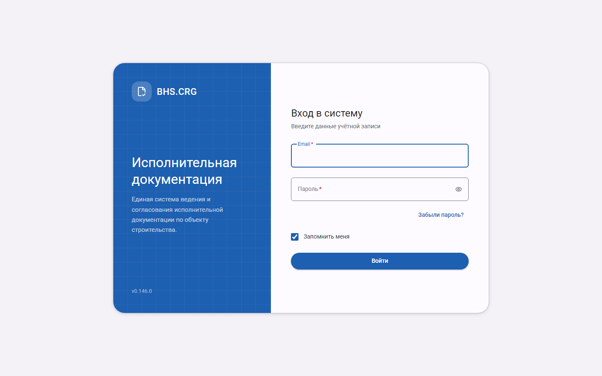

Забыли пароль — нажмите **«Забыли пароль?»** под полями: система пришлёт письмо со ссылкой на
смену. Ссылка живёт час и срабатывает один раз.

> Письмо не приходит — почта в системе может быть не настроена; тогда пароль сбрасывает
> администратор. Учётную запись для вас тоже создаёт он.
> Свои данные и пароль вы меняете сами после входа — раздел 11.

---

## 2. Общий обзор интерфейса

После входа слева — узкая панель **разделов**: **Стройки**, **Данные**, **Учёт**, а за чертой —
**Система** (её видит тот, кому открыто хоть что-то из администрирования). Раздел, в котором нет
ни одной открытой вам страницы, в панели не показывается. Рядом с разделами — **панель раздела**:
его название, строка о том, что в нём, и страницы раздела по группам. В центре — рабочая область.

Сверху — строка с тем, что относится к любому экрану. Слева — пространство и избранные стройки:
что сейчас видно. Посередине — поле **«Найти счёт, стройку или действие»**: оно открывает
командную палитру, ту же, что **Ctrl K**. Справа — кнопка активности: колокольчик уведомлений, а
пока идёт фоновая задача — пилюля с её ходом (см. раздел 9); дальше **«?»** — горячие клавиши, и ваш
аватар.

Щелчок по разделу открывает его первую страницу. Панель раздела скрывается кнопкой справа от её
названия — странице достанется больше места; вернуть её — кнопка в левом верхнем углу страницы или
щелчок по своему разделу. Выбор запоминается за вами, как тема: на другом компьютере будет так же.
Пока вы ничего не выбирали, в окне уже 1200 пикселей панель раздела скрыта сама. В карточке стройки
панели раздела нет: её место занимает навигация самой стройки.

Щелчок по аватару открывает меню — только то, что касается вас самих: имя, роли и почта;
**«Профиль и пароль»** (раздел 11); **оформление** — светлое, тёмное или **авто** (как в системе);
**«Сообщить о проблеме»** (раздел 10); **«Выйти»**. Самой нижней строкой — версия системы; когда
вышла новая, на аватаре стоит точка, а в меню — «доступна …». Меню
проходится и клавиатурой: стрелки ходят по пунктам, Esc закрывает его.

На телефоне и в узком окне панелей слева нет: меню открывается кнопкой **☰** в левом верхнем углу,
показывает все разделы сразу, каждый со своими страницами, и закрывается, как только выбрана
страница. Списки с карточкой справа (счета, накладные, типы, роли…) показывают сначала список, а
карточку — после выбора строки; вернуться к списку — **«К списку»** над карточкой. Окна на телефоне
открываются во весь экран.

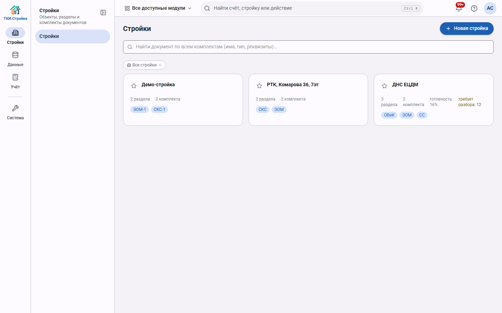

Разделы и их страницы:

| Раздел | Страницы |
|---|---|
| **Стройки** | Проекты (стройки) → разделы → комплекты документов |
| **Данные** | **Общие данные** — справочные данные, на которые ссылаются документы: организации, лица, объекты и всё прочее, заведённое администратором; **Наборы данных** — табличные данные (например, для ведомостей и журналов); **Документы качества** — библиотека сертификатов, деклараций, паспортов и привязки к материалам; **Сверка** — сходятся ли количества и значения между документами |
| **Учёт** («Учёт затрат») | **Счета**, **Накладные**; группа «Отчёты и закрытие месяца»: **Реестр счетов**, **Затраты по стройке**, **Учётный период** |
| **Система** («Администрирование») | Типы, шаблоны, пользователи, роли, журнал, параметры системы — см. «Инструкцию администратора» |

**С клавиатуры.** **Ctrl + K** открывает командную палитру — переход в любой раздел по первым
буквам названия, без мыши. Если на странице есть несохранённые правки, палитра спросит о них так
же, как пункт меню слева; а поверх окна с несохранёнными правками она не откроется — сначала
закройте окно. Клавиша **?** (когда курсор не в поле ввода) показывает
общий список сочетаний — он один на всю систему, часть из них работает на определённых экранах
(например, **← →** переключают вкладки в редакторе документа).

**Рабочие пространства.** Если вам доступно больше одного модуля (например, «Исполнительная
документация» и «Счета и накладные»), в шапке слева появляется переключатель пространства.
Пространство сужает меню до страниц выбранных модулей и тех разделов ядра, которыми они
пользуются (раздел **Система** оно не трогает): в пространстве «Счета и накладные» остаются счета, накладные, реестр и отчёт, а с ними
**Стройки**, **Общие данные** и **Учётный период**. На кнопке переключателя — только короткое имя
пространства. Его состав («2 модуля: …») написан в раскрывающемся списке у каждого пространства и
в подсказке кнопки: по нему видно, почему какого-то раздела нет в меню.

- **Пространство — удобство, а не ограничение доступа.** Ваши права оно не меняет. Скрытые
  разделы названы последней строкой панели раздела — **«Ещё N разделов вне пространства»**: она
  разворачивается списком, и раздел открывается, не меняя пространства. Ссылка из письма или
  уведомления тоже открывается как обычно; на такой странице наверху стоит плашка «… открыт вне
  пространства» с кнопкой **«Вернуться в пространство»**. **Ctrl + K** ищет разделы всех ваших
  модулей и помечает найденное «Вне пространства». Уведомления приходят из всех модулей.
- **Системные пространства** есть у всех: «Все доступные модули» и по одному на каждый модуль.
- **Своё пространство** заводится из переключателя — пункт **«Настроить пространства…»**: имя,
  галки модулей и **«Открывать при входе»**. Под галками окно пишет, какие разделы придут вместе с
  отмеченными модулями («Вместе с ними: Стройки, Общие данные…»), и показывает имя, которое
  встанет в шапке, и состав, который будет написан в списке пространств. Пока имя пустое,
  повторяет уже существующее или не отмечен ни один модуль, кнопка сохранения заперта, а причина
  написана под ней.
- **С какого пространства начинать работу**, выбирается в профиле (раздел 11) или галкой
  «Открывать при входе». Если не выбрано — открывается последнее выбранное. Выбор и свои
  пространства хранятся в учётной записи и приедут на любой компьютер.
- Если модуль стал вам недоступен, пространство называет это: «2 модуля; 1 недоступен».
  Пространство, в котором не осталось доступных модулей, при входе откатывается на «Все доступные
  модули» с сообщением, какого модуля не стало. Сам состав при этом не теряется: вернут доступ —
  пространство заработает как было.

При одном доступном модуле переключателя нет: сужать нечего.

**Как закрываются окна.** Щелчок мимо окна его не закрывает — промах мыши не должен стирать
набранное. Вместо этого на мгновение обводится кнопка выхода: **«Отмена»** или крестик.
Закрываются щелчком мимо только просмотры и окна выбора (расклад оплаты, лист PDF, выбор объекта):
в них нечего терять.

Клавиша **Esc** закрывает окно, пока в нём ничего не набрано. В форме с набранным она переносит
курсор на кнопку выхода — закрывает уже **Enter**; если правки не сохранены, окно спросит
**«Закрыть без сохранения?»**. Пока идёт запрос — сохранение, отправка — окно не закрывается ничем:
дождитесь ответа, иначе его исход остался бы неизвестным. Если Esc нажат в поле, которое само на
него отвечает (очистка поиска, отмена правки названия, подсказка в редакторе кода), окно его не
замечает.

Окно, которое сообщает итог или отказ — «Удаление невозможно», «Оплатить нельзя», итог
восстановления из копии, — закрывается только своей кнопкой (**«Понятно»**, **«Готово»**,
**«Закрыть»**): ни щелчок мимо, ни Esc его не уберут, пока вы не прочитали.

---

## Исполнительная документация: быстрый старт

Типовые сценарии модуля «Исполнительная документация» — шаги по порядку и ссылки на подробные разделы.

### Сценарий 1. Получить PDF документа

**Стройка → Раздел → Комплект → Документ → Реквизиты → PDF**

1. **«Стройки»** — откройте стройку или заведите новую кнопкой «Новая стройка» (раздел 3).
2. Внутри стройки откройте **раздел** (например, «ЭОМ») и **комплект** в нём (раздел 3).
3. В комплекте нажмите **«Добавить документ»** и выберите тип — например, АОСР (раздел 4.1).
4. Вкладка **«Реквизиты»** — заполните поля. Организации и людей выбирайте из общих данных: их не
   вписывают в каждый документ заново (разделы 4.3 и 5).
5. Если в документе есть таблица работ или материалов — вкладка **«Источники данных»** (раздел 4.4).
   Если к акту прикладываются сертификаты и паспорта — вкладка **«Документы качества»** (раздел 4.5).
6. Вкладка **«Генерация»** — сформируйте документ и скачайте **PDF** (раздел 4.6).

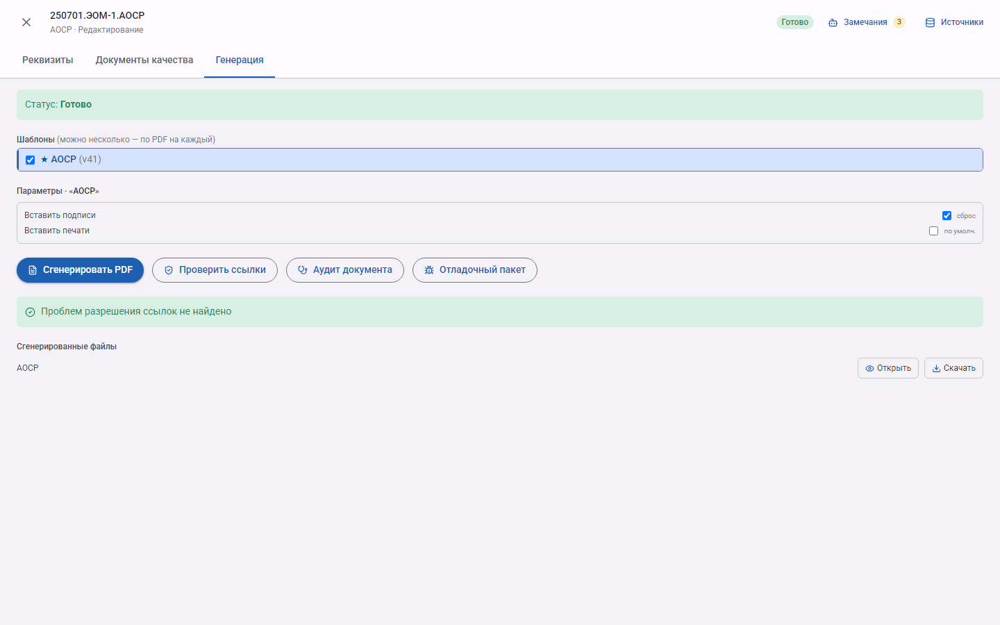

### Сценарий 2. Таблица из файла — в документ

Ведомость материалов, кабельный журнал или реестр работ не набирают руками, а берут из файла.

**Файл → Источник → Привязка в документе → PDF**

1. **«Данные» → «Наборы данных»** — загрузите файл: Excel, CSV, XML или PDF (разделы 6 и 6.1).
2. У файла появится **источник** — лист книги или распознанная таблица. При необходимости настройте
   колонки и фильтры (раздел 6.3) или добавьте вычисляемые колонки (раздел 6.4).
3. В документе откройте вкладку **«Источники данных»** или значок источника у поля-таблицы и
   привяжите набор (раздел 4.4).
4. Сформируйте PDF. Данные берутся при каждой генерации: заменили файл — следующий PDF соберётся из
   нового.

### Сценарий 3. Проверить, сходятся ли данные

1. **«Данные» → «Сверка»** — настройте сверку: например, «проложено кабеля не меньше проектного»
   (раздел 7.1), — и запустите её кнопкой **«Запустить»** (раздел 7.2).
2. Разберите **находки** — исправьте данные или признайте расхождение нормой (разделы 7.2 и 7.3).
   Счётчик «требует разбора» на карточке стройки обнулится, когда решение принято по каждой находке.

---

## 3. Стройки, разделы и комплекты

Работа с документами организована иерархически: **Стройка → Раздел → Комплект → Документы**.

1. На странице **Стройки** выберите стройку (или создайте новую кнопкой **«Новая стройка»**).

   Строка поиска над карточками ищет **документ по всем комплектам сразу** — по имени, типу
   документа и содержимому реквизитов. Это короткий путь, когда помните документ, но не помните,
   в каком он комплекте.

   На карточке стройки рядом с числом разделов и комплектов может стоять **«требует разбора: N»**.
   Это счётчик **сверки**: неразобранные находки её прогонов плюс непросмотренные замечания
   внешнего анализа по этой стройке (раздел 7). Разбираются они в разделе «Сверка» — там же
   счётчик и обнуляется, когда по каждой находке принято решение.

   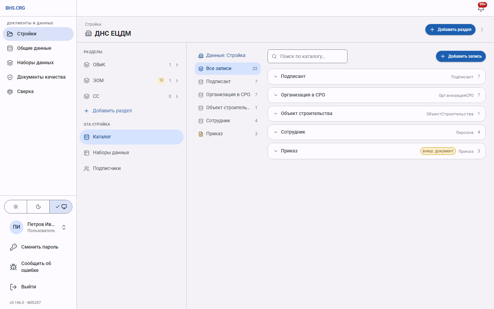

2. Внутри стройки — разделы (например, «ОВиК», «ЭОМ») и комплекты в них. Откройте комплект,
   чтобы увидеть его документы.

   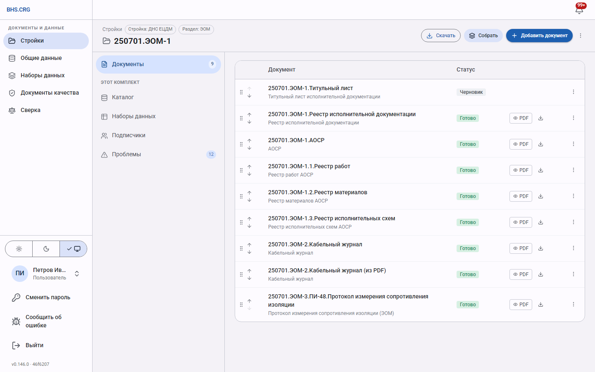

В комплекте также доступны **Каталог общих данных** и **Наборы данных** уровня комплекта.

### 3.1. План по документам и готовность

План отвечает на вопрос «сколько ещё осталось». Задаётся он **только на комплекте** — пункт
**«План»** в его левой навигации: добавьте типы документов и укажите, сколько каждого должно быть.

Дальше система считает сама:

- **готовым считается выпущенный документ** — тот, у которого сформирован PDF. Черновик позицию не
  закрывает: план считает выпущенное, а не заведённые карточки;
- **документы сверх плана процент не поднимают**, а типы, которых в плане нет, в него не входят
  вовсе. Пять актов при плане в три — это три закрытые позиции и два документа сверх плана;
- **раздел и стройка считаются сами** — складывают свои комплекты. Отдельно задавать план на них
  не нужно и нельзя;
- **комплекты без плана в процент не входят**, но и не молчат: рядом видно «без плана: N
  комплектов». Иначе «раздел на 100 %» означало бы «единственный расписанный комплект закрыт».

Процент показывается в шапке комплекта, раздела и стройки, в строках списков и на карточках строек.
**Плана нет — процента нет:** там, где не планировали, ничего и не должно.

> **100 % показывается, только когда план закрыт И у сверки нет неразобранного.** Если разобрать
> что-то осталось, процент останавливается на 99 % и рядом стоит «не разобрано: N» — это не сбой
> счёта, а напоминание: комплект по количеству собран, но данные ещё не сверены (раздел 7).

План ничего не запрещает: документ вне плана заводится как обычно, комплект собирается как обычно.
Это индикатор, а не замок.

### 3.2. Избранные стройки

Если строек много, а работаете вы с несколькими, отметьте их **избранными**: остальные скроются
из списков. Это **удобство, а не права** — скрытое никуда не делось, и показать его можно одним
щелчком.

**Как отметить.** Три способа, результат один:

- **звезда ☆ слева от названия** на карточке стройки;
- отбор **«Стройки»** над списком (например, **«Все стройки ▾»** на странице «Стройки») — в его
  окне список строек с галочками;
- раздел **«Избранные стройки»** в профиле (раздел 11).

В избранном может быть не больше 20 строек. Отмеченная стройка остаётся на экране до ухода с него —
список не сжимается под курсором, а сообщение внизу говорит, что остальные скрыты.

**Отбор «Стройки»** стоит в строке фильтров над списком, который он урезает, и называет состояние
словами: **«★ Избранные стройки · скрыто 11»** или **«Все стройки»**. Щелчок открывает окно: сверху
выбор **«Избранные стройки — 3 из 14»** или **«Все стройки — 14»**, под ним — список строек с
галочками. «Все стройки» показывает все, не трогая список избранного; «Избранные стройки» возвращает
отбор. Выбор хранится в учётной записи, действует сразу во всех списках и приедет на любой компьютер,
где вы войдёте. Пока избранного нет, выбирать не из чего — в окне только список строек.

Отбор стоит там, где список действительно урезан: на странице **«Стройки»**, в **списках счетов и
накладных** и в **«Учётном периоде»** (раздел 12). Отчёт **«Затраты по стройке»** (раздел 14)
сворачивает неизбранные стройки в одну строку, а списки выбора стройки показывают избранные первыми
(см. ниже). **«Реестр счетов»** фильтром не урезается — он только предлагает отбор (раздел 6.7).

**Избранные — в панели раздела.** Отмеченные стройки стоят в панели раздела «Стройки» группой
**«Избранные стройки»**: щелчок открывает карточку стройки.

**Список счетов** слева на странице «Счета на оплату» показывает счета, разнесённые хотя бы на одну
избранную стройку, — сумма в строке при этом целая, — а также **все неразнесённые** счета и счета со
ссылкой на удалённую стройку: их работа не должна прятаться за звездой. Отборы **«Разобрать»**,
**«Удалённые записи»**, **«В архиве»**, **«Не распознано»** и «только эта загрузка» фильтром не
урезаются — под ними отбора «Стройки» нет.

- Если все счета скрыты, вместо «Счетов пока нет» написано **«По избранным стройкам счетов нет.
  Скрыто фильтром: N.»** с кнопкой «Показать все стройки»; если поиск нашёл бы только скрытые —
  **«Среди избранных строек не найдено»** с кнопкой «Искать по всем стройкам».
- Счёт, открытый по ссылке и скрытый в списке, открывается целиком, а над ним стоит строка «Этого
  счёта нет в списке слева: он разнесён на стройки не из избранного».
- Разнесли открытый счёт на неизбранную стройку — сообщение «Сохранено. В списке счёт скрыт…» с
  кнопкой «Показать все». Переключение отбора «Стройки» открытый счёт не закрывает.

**Список накладных** показывает накладные избранных строек, а также накладные без стройки и со
ссылкой на удалённую стройку. Отбор **«Только „Сопоставить“»** фильтром не урезается, и отбора
«Стройки» при нём нет. Если все
накладные скрыты, написано **«По избранным стройкам накладных нет. Скрыто фильтром: N.»** с кнопкой
«Показать все стройки». Число скрытых верно, даже когда список показывает только 300 самых свежих
накладных. Поиск идёт по показанным, поэтому под поиском отбор над списком говорит **«часть
скрыта»** без числа, а если ничего не нашлось — **«Ничего не найдено. Накладные неизбранных строек
скрыты фильтром — среди них не искали»** с кнопкой «Искать по всем стройкам». Накладная неизбранной стройки открывается по ссылке
целиком, а над ней стоит строка «Этой накладной нет в списке слева». Сменили получателя открытой
накладной на неизбранную стройку — сообщение «Сохранено. В списке накладная скрыта…» с кнопкой
«Показать все».

**Списки выбора стройки** — объект счёта, разноска, получатель накладной, стройка в «Затратах по
стройкам», перенос и копирование документа — тоже показывают избранные, под заголовком
**«Избранные стройки»**. Нужна другая — выберите последний пункт **«Показать все стройки (ещё N)…»**:
список раскроется, а выбранное и набранное в форме останется на месте. Раскрытие действует на всю
открытую форму (в разноске — на все поля сразу), не запоминается и отбор «Стройки» не трогает.
Если стройка уже стоит, но не в избранном, она показана группой **«Не в избранном»** обычным
именем — это не ошибка и не удалённая стройка. В переносе и копировании документа поиск ищет по всем
стройкам; комплекты неизбранных строек показаны под заголовком «Остальные стройки».

**Как понять, что часть скрыта.** Над урезанным списком всегда стоит отбор
`★ Избранные стройки · скрыто N`. Убрать его нельзя нарочно: это напоминание, что вы видите не всё.

**Что фильтр НЕ трогает:**

- **поиск документов** ищет по всем стройкам; найденное в неизбранной стройке помечено
  «☆ не в избранном»;
- **ссылка на стройку, раздел или комплект** открывает их полностью. Если стройка не в избранном,
  над заголовком стоит строка «Стройка не в избранном — в списках она скрыта» с кнопкой
  **«Добавить в избранное»**;
- **числа**: счётчики и проценты на карточках остаются прежними.

**Новая стройка** сама попадает в избранное, если оно у вас уже непустое, — иначе, вернувшись к
списку, вы бы её не нашли. Если стройка удалена, она пропадает из избранного сама. Удалили последнюю
избранную — показываются все стройки, а не пустой список.

---

## 4. Работа с документом

### 4.1. Добавление документа
В открытом комплекте нажмите **«Добавить документ»**, выберите тип документа и подтвердите.
Новый документ появится в списке со статусом **«Черновик»**. Щёлкните по строке документа,
чтобы открыть диалог редактирования.

### 4.2. Страница документа
Документ открывается своей страницей: у неё есть адрес, им можно поделиться, а кнопка «Назад»
браузера или стрелка **«К комплекту»** слева вверху возвращают к комплекту. Рядом со стрелкой — имя
и тип документа, справа — действия, ниже — вкладки. С несохранёнными правками стрелка, меню,
переход в другой раздел и кнопка «Назад» браузера сначала спросят, сохранить ли их.

| Вкладка | Что делать |
|---|---|
| **Реквизиты** | Заполнить поля документа — в том числе ссылки на записи каталога |
| **Документы качества** | Сопоставить материалы с документами качества |
| **Генерация** | Сформировать и скачать PDF |
| **Источники данных** | Обзор привязок к наборам данных и применение шаблонов на весь документ (раздел 4.4). Цифра на вкладке — сколько источников устарели |

> Вкладок бывает три: **«Документы качества» показывается только у типов, где есть материалы**
> (реестр материалов, кабельный журнал). У протокола измерений или титульного листа её нет, и это
> не сбой настройки.

В шапке, рядом с именем:

| Кнопка | Что делает |
|---|---|
| **Выбрать основу** | Взять реквизиты из другого документа — «основы»: заполненное в ней подставляется сюда и обновляется вместе с ней (раздел 4.3). Появляется, когда в комплекте есть подходящий документ |
| Статус («Черновик», «Готово») | Показывает состояние документа |
| **Замечания** | Замечания к документу; цифра — сколько неразобранных. Нет замечаний — нет и кнопки |
| **Сохранить**, **Сохранить и закрыть** | Записать изменения. Показываются **только на «Реквизитах»**: на других вкладках сохранять нечего, там всё применяется сразу |

### 4.3. Реквизиты
Поля сгруппированы в **разделы** — они перечислены слева, у каждого счётчик вида «3/4»:
заполнено из скольких. Обязательные поля отмечены звёздочкой **\***; пока они пусты, документ
не сгенерируется.

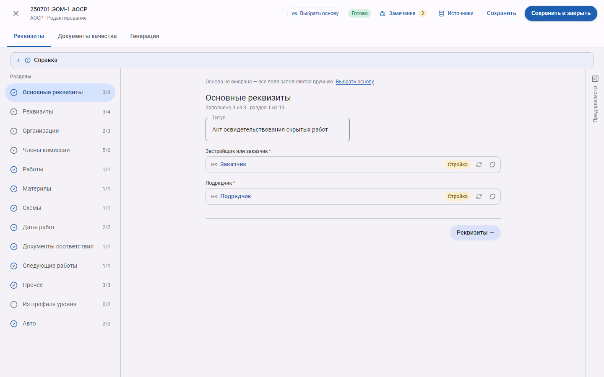

**Поля-ссылки** — те, что указывают на запись каталога (организацию, лицо, объект). Значок цепочки
перед значением означает, что это ссылка, а не набранный текст: данные подставляются из записи и
обновляются вместе с ней. Рядом со значением — метка уровня, откуда взята запись («Стройка»,
«Комплект»), и две кнопки: **«Заменить ссылку»** открывает выбор записи, **«Снять ссылку»**
**очищает поле целиком** — не превращает ссылку в текст, а стирает значение, так что заполнять
придётся заново.

**«Выбрать основу»** (в шапке) берёт реквизиты другого документа за образец: общие поля —
подрядчик, объект, комиссия — заполняются из него и остаются связанными. Пока основа не выбрана,
об этом сказано строкой над первым разделом.

**Поля с замком** заполняете не вы — их кладёт сама система (модуль, который ведёт этот вид
документов). Они убраны под свёрнутый раздел **«Заполняются автоматически»**, вместе с полями из
источников данных; подпись раздела говорит, сколько там чего. Значение такого поля видно и
копируется, но не правится, звёздочки обязательности у него нет, и в счётчик раздела оно не
входит — заполнять там нечего.

**Таблицы и вложенные поля.** Строка таблицы (материалы, работы, подписи) открывается окном; её
вложенные поля — единица измерения, организация, вариант — раскрываются в этом же окне, а не
следующим окном поверх. **«Вставить из Excel»** в окне таблицы и **«Вынести в общие данные…»** в
окне строки — шаги того же окна: **«Отмена»** или Esc возвращают к таблице или строке, набранное в
них цело.

Изменения записываются кнопкой **«Сохранить»** — она есть только здесь; на «Документах качества»,
«Генерации» и «Источниках данных» действия применяются сразу, и кнопок сохранения там нет вовсе.

### 4.4. Источники данных
Таблицы — ведомости материалов, кабельные журналы, реестры — приходят в документ из **наборов
данных**. Вкладка **«Источники данных»** — их обзор: какие наборы привязаны, всё ли с ними в
порядке, и применение готового шаблона привязки на весь документ. Цифра на вкладке — сколько
источников устарели (файл набора заменили, а данные ещё от прежнего): откройте её и перераспознайте.

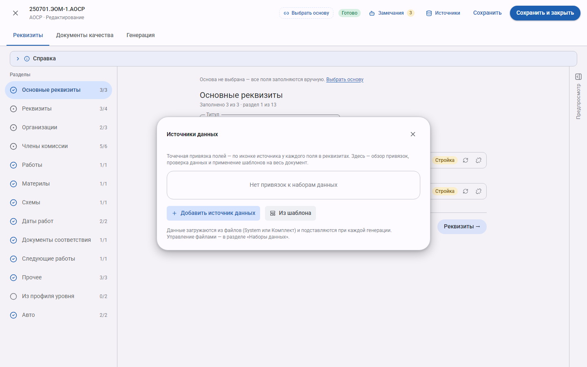

Точечно — какое поле из какой колонки — привязывается **у самого поля**, значком источника в
реквизитах. Данные подставляются при каждой генерации, то есть документ всегда собирается из
текущего содержимого набора; управление самими файлами — в разделе «Наборы данных» (раздел 6).

> **PDF-наборы (распознавание проектной документации).** Для PDF данные извлекаются
> распознаванием (ИИ), а не парсингом: реестр листов по ГОСТ-штампу, таблицы спецификаций и
> кабельных журналов. **Точность зависит от движка распознавания**, настроенного администратором:
> облачные (**Claude / Gemini**) распознают штамп/шифр надёжнее, чем офлайн-**Ollama** (у неё
> распознавание реализовано не полностью и может искажать шифр/наименование). Результат всегда
> можно поправить вручную — кнопка **«Редактировать разбиение»** (перенос листов между документами,
> правка шифра/наименования) и **«Перераспознать»** для отдельного документа. Если поля пусты или
> неверны — проверьте с администратором, какой движок включён.

### 4.5. Документы качества
Сопоставление материалов документа с документами качества из библиотеки. Сверху — счётчик вида
«130 материалов · привязано 54» и **область связи**: действует привязка только в этом комплекте
или шире.

Каждой строке материала соответствует документ качества. Привязать можно двумя путями: **вручную**
— значками в конце строки (выбрать документ, снять привязку) — или **списком**: кнопка
**«Предложения из библиотеки (N)»** показывает подобранные по релевантности (просроченные не
предлагаются), а **«Предложить по истории»** — те, что вы уже привязывали к такому же материалу
раньше. Предложения принимаются по одному или разбираются все сразу.

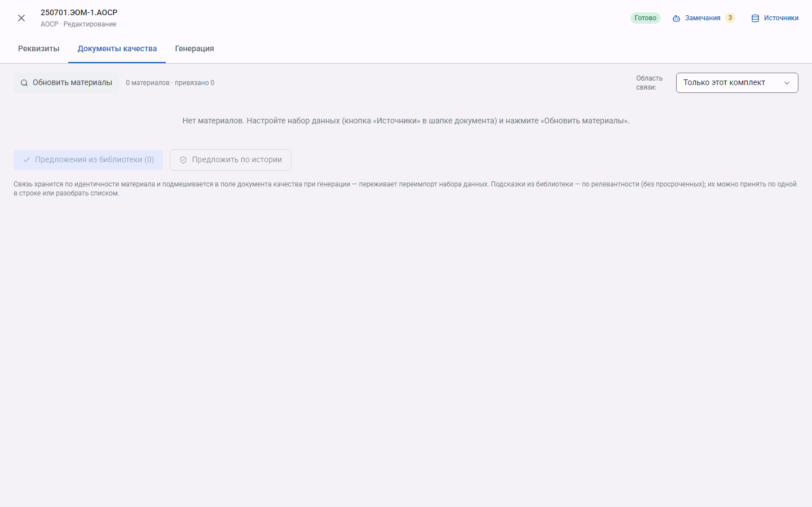

> Привязка хранится по идентичности материала и **подмешивается в документ при генерации** —
> она переживает переимпорт набора данных. Подробнее о библиотеке — раздел 8.

### 4.6. Генерация PDF
На вкладке **«Генерация»** сформируйте документ и скачайте готовый **PDF**.

> Если при генерации не заполнены обязательные поля, система сообщит об этом —
> вернитесь на вкладку «Реквизиты» и дозаполните.

---

## 5. Общие данные

Справочник, на который ссылаются документы: организации, лица, объекты — и любые другие виды
записей, заведённые администратором. Заполняются один раз и переиспользуются во всех документах:
поменяв здесь адрес организации, вы меняете его сразу везде, где на неё ссылались.

Раздел открывается на системном уровне — заголовок экрана так и называется, **«Системный каталог»**.
Слева — виды записей со счётчиками, справа — сами записи. Ищутся строкой поиска, добавляются
кнопкой **«Добавить запись»**.

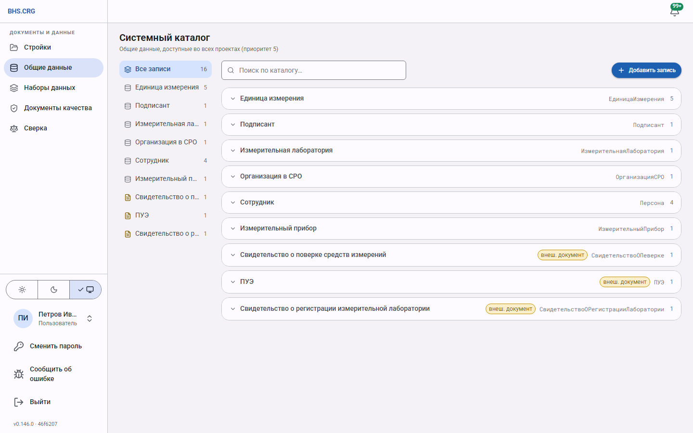

В формах документа этот же справочник называется **каталогом** — кнопка **«Выбрать из каталога»**
в поле‑ссылке (раздел 4.3) открывает именно его записи.

> Записи живут на разных уровнях: система → стройка → раздел → комплект. Заведённое на верхнем
> уровне видно на всех нижних, а одноимённая запись нижнего уровня перекрывает верхнюю — так
> общий подрядчик задаётся один раз, а «свой» на одной стройке подменяет его только там.

> **Запись, на которую ссылаются, удалить нельзя.** Система откажет и назовёт, кто держит: другие
> документы и записи — по именам, данные модулей — числом, например «строки счетов с этой позицией
> номенклатуры — 40», а при праве видеть счета — и номера счетов. Так же держат стройку, раздел и
> комплект. Сначала уберите ссылки — замените значение в счёте — и удаление пройдёт. Если модуль, чьи
> данные держат запись, выключен, ответ тот же: его данные остаются на месте, и убрать ссылку можно,
> только включив его.

### 5.1. Архив: убрать запись из выбора

Запись, которая больше не нужна, но уже стоит в документах и счетах, удалить нельзя — и освобождать
её часто незачем: документы закрыты. Такую запись отправляют **в архив**.

- **Что меняется.** В списках выбора — «Выбрать из каталога», базовый экземпляр, поиск номенклатуры в
  счёте — архивной записи больше нет.
- **Что остаётся как было.** Везде, где запись уже стоит, она на месте и печатается по-прежнему.
  Править архивную запись можно: исправленный адрес уйдёт и в старые документы.

Кнопка **«В архив»** появляется в строке записи при наведении, рядом с «Удалить». Подтверждения нет:
действие обратимо, а во всплывающем сообщении есть **«Вернуть»**. Если удаление отказало, потому что
запись занята, тот же выход предложит сам отказ — кнопкой **«Отправить в архив»**.

Если запись держат только данные **выключенного** модуля, убрать ссылки негде. Тогда под
предложением архива отказ говорит, что запись можно удалить, потеряв ссылки. Делает это
администратор: у него там кнопка, у остальных — строка о том, к кому обратиться. Несколько таких
записей администратор удаляет разом — из меню в шапке списка типа. То же со стройкой, разделом и
комплектом: если их держат только данные выключенного модуля, отказ удаления называет этот выход.

Архивные записи не пропадают со страницы: в конце списка каждого вида стоит свёрнутая строка
**«В архиве: N»**. Раскройте её — у архивной записи вместо «В архив» кнопка **«Вернуть из архива»**.
Поиск по странице ищет и в архиве, поэтому перед «Добавить запись» достаточно набрать название:
если такая запись лежит в архиве, вы её увидите и вернёте, а не заведёте вторую. Счётчики слева
считают только действующие записи.

> **Чего архив не делает.** Сотрудника он не увольняет: дата «Уволен с» задаётся отдельным полем и
> от архива не зависит. Документ в архив не отправляется — только записи справочников. Профиль
> уровня («Данные: стройка») — тоже нет. Записи справочников, которые ведёт модуль (например, статьи
> вне строек у счетов), с этой страницы в архив не уходят — у них свой путь, см. ниже.

**В счетах и накладных.** Архивная организация не предлагается поставщиком и плательщиком, архивная
позиция — в поиске номенклатуры, архивная статья — в выборе цели разноски. Там, где запись уже
стоит, она остаётся с названием и пометкой **«в архиве»**: счёт с ней читается, правится и
сохраняется как обычно. Заменив её другой и сохранив, выбрать её заново уже нельзя — об этом
заранее говорит подсказка под полем. Попытка поставить архивную запись в новый счёт или накладную
(например, из старой открытой вкладки) кончится отказом с объяснением.

**Статьи вне строек** отправляют в архив в их собственном справочнике: «Счета» → **«Статьи вне
строек»** → значок архива в строке статьи. Право то же, что на ведение справочника. Архивные статьи
лежат в том же окне под строкой **«В архиве: N»** и возвращаются одной кнопкой. Удалить статью, на
которую уже что-то разнесено, нельзя — отказ сам предложит **«Отправить в архив»**. Завести статью
с названием архивной тоже нельзя: система попросит вернуть прежнюю, чтобы затраты одного склада не
разошлись по двум статьям.

**Когда запись находит не человек, а система.** Значение из таблицы или набора данных система сама
сопоставляет с записью справочника — и архивную запись она находит тоже, но молча не подставляет:

- **«Вставить из Excel»** в таблицу документа: значения, совпавшие с записью в архиве, сводка перед
  вставкой называет отдельной строкой **«В архиве: N»**. По умолчанию они вставляются встроенно, как
  обычный текст. Флажок **«Вернуть из архива и связать»** возвращает эти записи в справочник и
  ставит на них ссылки; он виден тому, кто ведёт общие данные.
- **«Вынести в общие данные»**: если такая запись уже лежит в архиве, окно скажет **«Такая запись
  есть в архиве»** и предложит **«Вернуть из архива и связать»** вместо создания второй.
- **Привязка набора данных к записи справочника**: сохранение записи новую ссылку на архивную запись
  не ставит, а уже стоявшую не трогает. **«Проверить связки»** различает эти случаи: **«в архиве»**
  — связка стоит и работает, делать ничего не нужно; **«в архиве — не подставлено»** — источник
  называет архивную запись, которой в поле не было, и поле не заполняется. Это не «не найдено»:
  запись есть, верните её из архива и сохраните запись заново.
- **Документ с привязкой набора** собирается заново при каждом выпуске, поэтому архивная запись в
  нём остаётся — старый документ печатается как печатался, — а проверка документа один раз на
  значение предупреждает, что источник называет запись из архива.
- Системный набор **«Общие данные: …»** отдаёт и архивные записи, с колонкой **«ВАрхиве»** (да/нет).
  Нужны только действующие — отберите строки фильтром по этой колонке.

Если с одним ключом есть и действующая запись, и архивная, система всегда берёт действующую — на
каком бы уровне она ни лежала.

**В формах документов и записей.** Ссылка на запись в архиве выглядит обычной плиткой с пометкой
**«в архиве»** после названия — не красной: запись не потеряна, документ с ней печатается как
печатался. В ячейке таблицы пометка — значок, слова в подсказке. Окно выбора для такого поля
показывает первой строкой **«Сейчас: … — в архиве»**; нажать её значит оставить как есть.

**Не нашли запись в окне выбора.** Наберите название в поиске: под действующими записями появится
раздел **«В архиве»** с подходящими архивными. Кнопка **«Вернуть и выбрать»** возвращает запись в
справочник — для всех — и сразу ставит её в поле; она видна тому, кто ведёт общие данные. Стрелками
и Enter в этот раздел не попасть: вернуть запись из архива случайно нельзя.

**Заводите запись, а такая уже есть в архиве.** Если у новой записи совпали **поля идентичности** с
архивной (ИНН, артикул — те поля, что отмечены в типе), а действующей такой нет, система её не
создаст и покажет в форме строку **«Такая запись есть в архиве: …»** с двумя кнопками:
**«Вернуть из архива»** — прежняя запись возвращается, ссылки на неё целы, второй такой же не
появляется; **«Создать новую»** — завести всё-таки вторую. По одному совпавшему названию отказа нет.

**Сохранение не прошло: «запись тем временем изменили».** Пока форма записи была открыта у вас,
эту же запись сохранил кто-то другой (или вы сами — в соседней вкладке), либо её убрали в архив или
вернули оттуда. Правка заменяет запись целиком, и сохранённая поверх она стёрла бы чужие изменения —
поэтому система её не записала. Набранное остаётся в форме: перепишите то, что нужно, закройте
форму, откройте запись заново — в ней будет свежее содержимое — и внесите правку ещё раз.

**Сохранение не прошло: «запись … в архиве, поставить ссылку на неё нельзя».** Так отвечает сам
сервер, если в документ, запись справочника или документ качества попала **новая** ссылка на
архивную запись — мимо окна выбора: из внешней программы, или запись ушла в архив, пока форма была
открыта. Сообщение называет поле и запись — так, как она названа в справочнике. То же относится к
**основе** документа или записи: новую основу из архива поставить нельзя, стоявшая остаётся. Выходов два: вернуть запись из архива и сохранить снова
либо выбрать другую. Ссылки, которые в документе **уже стояли**, под правило не попадают: документ
с ними открывается, правится и сохраняется как прежде, и переставить такую ссылку из одного поля в
другое тоже можно. Но снятую и сохранённую ссылку обратно не поставить — только вернув запись.
Копия и перенос документа в другой комплект стоявшие ссылки сохраняют. **«Вынести в общие данные»**
тоже: ссылки внутри выносимого значения переезжают в новую запись вместе с ним — если документ или
запись, из которых выносят, с этими ссылками уже сохранены.

---

## 6. Наборы данных

Табличные данные, которые подключаются к документам (ведомости, журналы). Загрузите файл
(CSV/Excel/XML и др.), при необходимости настройте колонки, фильтры и вычисляемые поля.

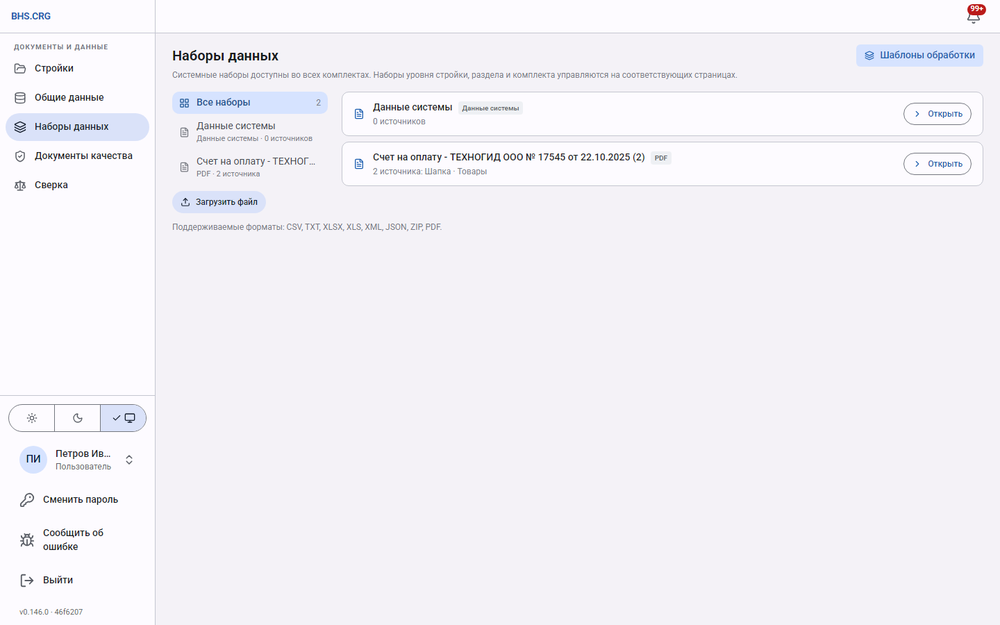

### 6.1. Файл и источники

Загруженный файл — это **сырьё**. К документу подключается не файл, а **источник**: лист книги,
ветка XML, распознанная таблица PDF. У одного файла источников может быть несколько — например,
шапка счёта и его товарные строки.

### 6.2. Наборы верхних уровней

Набор живёт на уровне, где его загрузили: комплект, раздел, стройка или система. **Наборы верхних
уровней доступны на нижних**: справочник, загруженный на стройку, подключается к документам любого
её комплекта, а системный — к документам всех строек.

В списке наборов уровня свои идут первыми, а под ними — свёрнутая строка
**«Доступны здесь: ещё N наборов с верхних уровней»**. Разверните её, чтобы увидеть остальные:
у каждого подписан уровень-владелец — «Раздел», «Стройка», «Система».

Унаследованный набор открывается и правится как свой: у него те же источники, фильтры и
материализация. Помните, что он **общий** — заменив файл или удалив набор раздела с экрана
комплекта, вы измените его для всех комплектов этого раздела. Перед удалением система об этом
предупреждает.

### 6.3. Обработка источника

У каждого источника своя цепочка обработки, она применяется в этом порядке:

1. **Вычисляемые колонки** — новые колонки, посчитанные по существующим;
2. **Фильтрация строк** — какие строки оставить;
3. **Сортировка строк**.

Вычисляемые колонки идут **до** фильтрации, поэтому по ним можно фильтровать.

В условии фильтра, кроме «равно», «содержит», «больше» и «пусто», есть **«между»** (две границы:
период или диапазон сумм) и **«в списке»** / **«не в списке»** (значения добавляются по одному,
клавишей Enter). У источника, построенного на таблице модуля — например, «Счета на оплату», —
колонке предлагаются только подходящие ей условия: сумме — «больше», «между», «не определено», но не
«содержит»; дата выбирается из календаря.

У колонок с закрытым перечнем значений — **«Состояние документа»** и **«Состояние оплаты»** —
значение не набирают, а **выбирают из списка**; для «в списке» значения отмечаются галочками.
Условий «содержит» и «начинается с» у таких колонок нет. Слово, которого в перечне нет (например,
с опечаткой), фильтр не примет и назовёт причину — раньше такое условие сохранялось и молча не
находило ничего.

У «Счетов на оплату» две колонки считаются **от сегодняшнего дня** и нигде не хранятся — завтра они
покажут другое, и пересчитывать их никому не нужно:

- **Осталось дней** (`ДнейДоСрока`) — сколько дней до срока «оплатить до». В день срока — 0, у
  просроченного счёта число отрицательное: «−3» значит «просрочен на три дня».
- **Просрочен** (`СрокПросрочен`) — да или нет. В сам день срока счёт ещё не просрочен.

Обе относятся только к счёту, который **ждёт оплаты**: у оплаченного полностью, у отклонённого и у
счёта без срока «Осталось дней» пусто, а «Просрочен» — «нет».
По обеим колонкам можно фильтровать и сортировать: «Просрочен равно да», «Осталось дней между 0
и 3»; при сортировке по «Осталось дней» самые просроченные идут первыми, счета без срока — в конце.

«Просрочен» пустым не бывает, поэтому условия «не определено» и «определено» по нему ничего не
отбирают: первое не найдёт ни одного счёта, второе — все. Счета без срока отбирает условие по
колонке **«Оплатить до»** — «не определено».

«Сегодня» берётся в часовом поясе компании. ⚠️ Пока пояс компании не задан, действует пояс
сервера, а в поставке это всемирное время (UTC): новый день наступает в 03:00 по Москве, и до этого
часа счёт со сроком «вчера» ещё показывает «Осталось дней: 0» и «Просрочен: нет». Пояс выбирает администратор: «Система» → «Параметры системы» → «Компания».

Фильтр проверяется при сохранении. Условие, которое источник выполнить не сможет, подписано красным
сразу, а при нажатии **«Сохранить»** окно не закроется и назовёт причину: «условие 1 по колонке
„Итого“: …». Номер условия стоит слева от него; во вложенной группе он составной — «2.1» значит
первое условие в группе, стоящей второй. Исправьте условие и сохраните снова — фильтр, который источник не
выполнит, не сохраняется вовсе. Пока идёт сохранение, окно не закрывается.

Если, пока окно было открыто, обработку этого источника изменил кто-то другой, сохранение не пройдёт:
окно останется открытым и скажет, что **источник тем временем изменили**. Ваша правка собрана по
прежней обработке и затёрла бы чужую. Закройте окно, обновите страницу и внесите правку заново — окно
покажет обработку, какой она стала. То же сообщение появится, если страница открыта со времён прежней
версии приложения: её достаточно обновить. Так же ведут себя **«Сохранить как шаблон»**,
**«Редактировать»** источника и **«Материализация»**.

Готовую цепочку можно сохранить как **шаблон обработки** и применить к другому источнику —
удобно, когда каждый месяц приходит файл одной и той же формы. Если фильтр шаблона этому источнику
не подходит (например, шаблон сравнивает сумму как текст), шаблон не применится и причина будет
названа; источник при этом останется прежним.

### 6.4. Вычисляемые колонки

Колонка задаётся именем и выражением на JavaScript. К колонке источника можно обратиться
**тремя способами** — они равноправны, выбирайте удобный:

| Способ | Пример | Когда нужен |
|---|---|---|
| по имени | `Фамилия + ' ' + Имя` | имя колонки годится в имя переменной |
| `get("…")` | `get("Кол-во")` | подходит **всегда**, в том числе для имён с пробелами, дефисами и цифрами |
| `cols[n]` | `cols[3]` | по номеру колонки, **счёт с единицы** |

Заголовок вроде `1`, `2`, `3` (обычное дело для таблиц, распознанных из PDF) или `Кол-во`
переменной стать не может: выражение `1` вернёт просто число, а `Кол-во` движок прочитает как
вычитание. Для таких колонок пользуйтесь `get("1")` или `cols[1]`.

Чтобы не набирать имена вручную, нажмите на колонку в списке **«Колонки источника»** — в
выражение подставится то, что действительно работает.

> Пустая ячейка числовой колонки в документ не попадает: в поле останется пусто, а не ноль.

### 6.5. Материализация

Источник можно **развернуть в сущности выбранного типа**: каждая строка станет объектом
(например, измерением или материалом). Маппинг «колонка → поле» задаётся один раз в диалоге
**«Материализация»**, после чего документы совместимого типа ссылаются на источник без
собственной настройки.

### 6.6. Данные системы

Набор бывает и **без файла**: сырьё берётся из самой системы. Кнопка **«Данные системы»** рядом с
«Загрузить файл» создаёт такой набор — по одному на уровень (стройка, раздел, комплект). Источники
у него выбираются из готового списка консолидаций; сегодня это **«Документы комплекта»** —
перечень всех документов того комплекта, в котором создан набор:

| Колонка | Что содержит |
|---|---|
| НомерПП | сквозной номер по порядку в комплекте |
| Наименование | имя документа (если не задано — имя его типа) |
| ТипКод, ТипИмя, Группа | тип документа и его группа |
| Статус | черновик / генерируется / сгенерирован / ошибка |
| НомерДокумента, ДатаДокумента | реквизиты с тэгами «Номер документа» и «Дата документа» |
| ДатаГенерации, КоличествоЛистов | заполняются автоматически при генерации PDF |
| Ид, ПорядокВКомплекте | служебные — для фильтров и отладки |

Три колонки реквизитов берутся **по функциональным тэгам**, а не по именам полей: у каждого типа
документа своя схема, и тэг — единственное, что их связывает. Если у типа нет поля с нужным тэгом
или оно не заполнено, ячейка будет пустой, но строка документа никуда не денется.

Такой источник — обычный: к нему применимы фильтрация, вычисляемые колонки, сортировка, экспорт в
Excel и материализация. Данные **всегда свежие** — они собираются заново при каждом обращении, так
что добавленный в комплект документ появляется в источнике сразу, без «обновить».

#### Реестр документов комплекта

Типовой сценарий (настраивает администратор):

1. **Составной тип** «СтрокаРеестра» с полями будущей таблицы: номер, наименование, номер
   документа, дата, количество листов.
2. **Тип документа** «Реестр документов» с полем-массивом (тип элемента — «СтрокаРеестра»).
3. В комплекте: **«Данные системы»** → источник **«Документы комплекта»**.
4. В документе-реестре — вкладка **«Источники данных»** (или значок источника у самого поля-массива):
   привязать источник и сопоставить колонки полям (раздел 4.4).
5. **Шаблон** Typst печатает массив таблицей. Какую дату показывать — заполненную вручную
   (`ДатаДокумента`) или дату генерации PDF (`ДатаГенерации`) — решает шаблон: источник отдаёт обе.

Группы реестра («Основные документы», «Сертификаты») делаются **несколькими источниками на одну
консолидацию** — одни и те же живые данные, разные фильтры, разные поля документа. Два пути:

- **«Добавить ещё»** у той же консолидации в списке «Доступно из данных системы» — уже добавленная
  консолидация остаётся видимой, с пометкой «уже добавлен»; новый источник заводится пустым;
- **«Создать копию…»** в меню источника — копия наследует фильтр, вычисляемые колонки, сортировку и
  материализацию (вместе с правилом выбора варианта), останется поправить только отличия.

Оба пути спрашивают название, и оно обязано быть свободным: при привязке источники различимы
**только названием**, поэтому два «Документы комплекта» подряд означали бы выбор наугад. Называйте
по назначению — «Основные документы», «Сертификаты», — а не «копия».

#### Разные виды документов в одном реестре

Если строки реестра должны выглядеть по-разному — титульный лист одним набором полей, АОСР другим,
— тип строки делают **union'ом** («заполняется ровно один вариант»), а в диалоге материализации
выбирают режим **«вариант по типу документа строки»**.

В этом режиме указываются:

- **колонка-признак** — по ней определяется, что за документ в строке. У источника «Документы
  комплекта» это «ТипКод» (код типа) либо «Ид» (сам документ);
- **какие типы документов относятся к какому варианту**. Правило на тип забирает и все его подвиды,
  поэтому перечислять потомков не нужно. Вариант, которому не назначено ни одного типа, **выключен**:
  строки таких документов в реестр не попадают — это законная настройка, если реестр собирает не всё.

Предпросмотр показывает вариант каждой строки и **отдельно перечисляет пропущенные** — с указанием,
почему: тип не назначен ни одному варианту, код типа не распознан, документ по идентификатору не
найден. Смотреть туда стоит до генерации: недостача в готовом реестре в глаза не бросается.

Настройка не сохранится, если она противоречива — например, один тип назначен двум вариантам сразу
или варианту назначены типы, но не задан маппинг колонок.

> Если у привязки задан **собственный** маппинг, он замещает материализацию целиком — вместе с
> правилом выбора варианта. Плоский маппинг привязки построчную вариативность не выражает.

> Реестр — тоже документ комплекта и попадает в собственный перечень. Система его не исключает сама:
> реестры по ГОСТ вполне законно включают себя, и скрытое правило пришлось бы обходить. Если это не
> нужно, исключите его **фильтром строк** по типу документа.
>
> Количество листов у соседних документов известно только после их генерации. При сборке комплекта
> система учитывает это сама: документы, читающие данные системы, перегенерируются **после**
> остальных. При одиночной генерации реестр показывает то, что есть в системе на этот момент.

### 6.7. Реестр счетов: отбор, колонки, сортировка, итог

Раздел **«Реестр счетов»** открывает счета таблицей — в том виде, в каком реестр ведут в Excel:
поставщик, сумма, номер и дата счёта, дата отгрузки, отсрочка, «оплатить до», осталось дней,
состояние оплаты, объект, плательщик, назначение. Последняя колонка — **«Строк без позиции»**: сколько
строк счёта стоит без позиции номенклатуры (пусто — таких строк нет). Это то же число, что счётчик в
списке счетов. Очередь «Разобрать» в реестре — отбор «Состояние документа = Черновик»: это все
недоведённые счета. Отклонённый счёт в очередь не входит, хотя строки без позиции у него остаются.

Реестр — **готовая настройка таблицы счетов**, а не отдельный отчёт: это та же таблица модуля, на
которой строится источник «Счета на оплату», с названным составом колонок, итогами под обеими суммами
и закреплённым поставщиком. Всё, что описано ниже, относится и к реестру, и к таблице целиком. К
**таблице целиком** — всеми колонками, без настройки реестра — ведёт ссылка под заголовком реестра;
отбор при переходе сохраняется.

**«Навести порядок» — готовые отборы над таблицей.** Если в счетах выбраны записи общих данных,
которых больше нет, над рядом условий появляется строка «Навести порядок» с числом счетов:

- **«Ссылки на удалённые записи»** — счета, в которых стоит запись, удалённая из общих данных:
  поставщик, плательщик, позиция номенклатуры, стройка, раздел или статья. Такой счёт неполон —
  откройте его и замените запись.
- **«Записи в архиве»** — счета в работе (не оплаченные и не отклонённые), в которых стоит запись,
  убранная в архив. Счёт верен, и править его не обязательно; оплаченные и отклонённые счета с архивной
  записью сюда не входят вовсе.

**«Объект: избранные стройки»** — кнопка над рядом условий, когда включены «Избранные стройки»
(раздел 3.2). Сам реестр фильтром не урезается: открытый под фильтром, он показывает все счета, и
итоги в нём — итоги всех счетов. Нажатие ставит условие «Объект: …» по названиям избранных строек,
и «Сумма» под ним, как под любым условием по объекту, — доля счетов на эти стройки. Отбор идёт по
названию: если у неизбранной стройки или у статьи вне строек то же название, что у избранной стройки,
их счета попадут тоже — об этом сказано рядом с кнопкой. Нажатие **заменяет** прочие условия по колонке
«Объект»: два условия по объекту сразу дали бы «Сумму», не подходящую ни к одному из них (подсказка у
кнопки об этом предупреждает). Сменили избранное — кнопка снова предлагает отбор, и нажатие заменит
прежнее условие новым.

Нажатие ставит обычное условие отбора — оно появляется в ряду условий, снимается крестиком и
сочетается с остальными («удалённые записи у этого поставщика за сентябрь») — и добавляет в таблицу
колонку, по которой отбор идёт. Повторное нажатие условие снимает. Число на кнопке — по всей таблице,
а не под остальными условиями экрана.

В отбор «Ссылки на удалённые записи» попадает только то, что можно исправить. Счёт закрытого периода
в колонке назван **«есть, период закрыт»**, счёт с удалённым типом — **«удалён тип счёта»**: их видно,
если включить колонку и отобрать по этим словам, но число на кнопке их не считает. Строки «Навести
порядок» нет, когда исправлять нечего, и у того, кто счета не правит (право `costs.invoice.edit`).
Надпись **«не проверено»** вместо числа значит, что часть данных прочитать не удалось: это не «счетов
нет» — сообщите администратору.

**Оплата в реестре — четырьмя колонками.** «Состояние оплаты» и «Оплачен» (дата платежа) — про сам
платёж. «Учётный период» — месяцы, в затраты которых вошли деньги счёта: обычно один («09.2026»), а
у счёта на несколько строек, часть которых была закрыта на дату платежа, — несколько. «Суммы по
периодам» называют деньги каждого месяца: «40 000,00 (09.2026) + 60 000,00 (10.2026)»; эта колонка
— под тем же правом, что остальные суммы.

Отбор «Учётный период равно 10.2026» находит счета, у которых в октябрь вошла **хотя бы часть**
денег, — и «Суммы по периодам» под таким отбором показывают только названный месяц (об этом говорит
подпись у заголовка). Под отбором **по объекту** в «Суммах по периодам» остаются только деньги,
разнесённые на названный объект, — как и в колонке «Сумма»; подпись «доля: …» стоит у обеих. По
«Суммам по периодам» не отбирают и не сортируют; сортировка по «Учётному периоду» — по самому раннему
месяцу счёта.

**Деньги названного месяца — в колонке «Сумма».** Под отбором по учётному периоду она показывает не
счёт целиком, а то, что из него вошло в названные месяцы: у счёта на 100 000, из которых в октябрь
вошли 40 000, под отбором «Учётный период равно 10.2026» в «Сумме» стоит 40 000 — и в итоге колонки
тоже. Если отбор называет ещё и объект, остаётся доля этого объекта в этих месяцах; когда на объект в
названный месяц ничего не легло, клетка пуста. О сужении говорит подпись у заголовка и под итогом —
«только периоды, названные отбором».

> «Сумма к оплате» и «В том числе НДС» под таким отбором **не сужаются**: это счета целиком, и под их
> итогами стоит подпись «счета целиком, а не деньги названного периода». Затраты месяца — итог «Суммы».

**«Исправлен после закрытия»** — день, когда закрытые деньги счёта двигались в последний раз:
исправление, отмена или новая оплата запертого счёта, выравнивание допуском; у неисправленного клетка
пуста. Колонка стоит в реестре сразу за «Суммами по периодам» и видна тем, кому открыты счета на оплату;
исправленные счета находит обычное условие «не пусто», а «что исправляли в октябре» — условие «между» по
датам. Реестр показывает счета **как они есть сейчас**: если в месяцах, названных отбором по учётному
периоду, деньги после закрытия исправляли, под итогом «Суммы» стоит подпись «в названных месяцах есть
исправления после закрытия (на момент закрытия — «Затраты по стройке»)» — даже если исправленный счёт из
отбора ушёл (например, оплату отменили). Закрытый месяц таким, каким его закрыли, показывает отчёт
(раздел 14). В боковой панели исправленного счёта блок «Разноска» говорит, когда и чем счёт исправлен
последний раз — «исправление», «отмена оплаты», «новая оплата» или «выравнивание допуском», с причиной,
если она есть. В списке на экране «Счета» такой счёт помечен словом «исправлен»; история — в карточке
счёта, секция «Исправления».

Над таблицей — **чипы отбора**. Каждый чип — одно условие и называет его целиком: колонку, условие и
значение («Состояние оплаты: Не оплачен», «Оплатить до: 01.10.2026 — 31.10.2026», «Осталось дней
< 0»). Чипы действуют вместе: в таблице остаются счета, подходящие под все.

- **«+ условие»** — добавить чип: колонка, условие, значение. Значение вводится по виду колонки —
  дата из календаря, состояние из списка, «да / нет» у «Просрочен».
- В реестре рядом стоят готовые места под привычные отборы: **«+ Дата счёта»** (период), **«+
  Плательщик»**, **«+ Поставщик»**, **«+ Объект»**, **«+ Состояние оплаты»**. Место — ещё не условие:
  отбор появляется, когда введено значение, — до того кнопка «Добавить» заперта. Нужны счета, где
  поставщик не указан, — выберите условие «пусто». У даты место сразу открывается периодом «между».
  Колонка, по которой условие уже стоит, местом не предлагается: оно правится чипом.
- Щелчок по чипу — поправить условие; **крестик** — снять его. Снятие меняет сам отбор: таблица
  перечитывается.
- **«Снять отбор»** — убрать все условия разом.
- **«Расширенный»** — то же дерево условий, что у фильтра источника (раздел 6.3): условия можно
  связать «ИЛИ» и собрать в группы. Такой отбор рядом чипов не показать, поэтому над таблицей он
  назван **«Отбор сложный»** с числом условий и правится там же, в расширенном режиме.

Условие, которое выполнить нельзя (не задано значение, колонка закрыта правом, поле удалили из
типа), остаётся на экране **красным чипом с причиной**, а на месте строк стоит отказ: таблица не
показывает строки, полученные под другим отбором. Если под условия не подошёл ни один счёт, таблица
так и говорит — «Отбор ничего не нашёл», — и чипы остаются на месте.

**Сортировка.** Щелчок по заголовку колонки сортирует таблицу: первый — по возрастанию, второй — по
убыванию, третий — снимает сортировку. Щелчок с **Shift** добавляет колонку к уже выбранным — вторым
ключом (сначала по поставщику, внутри — по дате); рядом со стрелкой тогда стоит номер ключа. По
колонке «Сумма» не сортируют: под отбором по объекту она значит долю счёта, а не его сумму.

**Из строки — в счёт.** В первой клетке каждой строки стоит стрелка **«Открыть счёт»** — ссылка на
форму этого счёта в разделе «Счета». Это обычная ссылка: щелчок средней кнопкой или с **Ctrl**
открывает счёт в новой вкладке, а с клавиатуры до неё доходят клавишей Tab. Та же ссылка есть в
боковой панели строки. Кнопка браузера **«Назад»** возвращает в реестр с тем же отбором, сортировкой
и составом колонок. Ссылки нет у того, кому раздел «Счета» закрыт (нет права «видеть счета на
оплату»): строки реестра ему видны, а форма счёта — нет.

**Колонки.** Кнопка **«Колонки»** справа над таблицей открывает их список — все колонки таблицы, а не
только показанные:

- галочка — показать или убрать колонку; стрелки — поставить её левее или правее;
- **итог** — что считать под колонкой: у числа сумма, среднее, наименьшее, наибольшее или количество,
  у даты — наименьшая, наибольшая и количество, у остальных — количество;
- **«Закрепить слева»** — первые одна–три колонки остаются на месте при прокрутке таблицы вбок;
- **«Как у таблицы»** — вернуть состав колонок, итоги и закрепление к исходным. В реестре кнопка
  называется **«Как в «Реестр счетов»»** и возвращает его настройку.

**Итог** стоит в нижней строке таблицы и считается **по всему отбору, а не по странице**: на второй
странице он тот же. Если в колонке попались значения, которые посчитать нельзя, под итогом сказано,
сколько их и почему: «не учтено 3 значения: не число» — сумма не становится меньше молча.

**Что значит «Сумма» под отбором — сказано подписью**, в заголовке колонки и под её итогом:

- под отбором по **объекту** это **доля** счёта по разноске на названные объекты («доля: Комарова
  36»); счёт целиком стоит рядом, в «Сумме к оплате»;
- под отбором по **разделу** — доля на названные разделы («раздел: Комарова 36 / 4 эт.»). Раздел в
  реестре назван **вместе со стройкой**: «4 эт.» есть на каждой стройке, и по одному названию их не
  различить. Доля, разнесённая на стройку целиком, — «Комарова 36 / без раздела». Отбор «Раздел
  содержит 4 эт.» находит четвёртые этажи всех строек разом. Колонки «Раздел» в «Реестре счетов» по
  умолчанию нет — её включают кнопкой «Колонки»; отбор работает и без неё;
- под отбором по **дате счёта** — «период — по дате счёта; затраты периода — отбор „Учётный
  период“». Итог тогда равен сумме счетов, выставленных в периоде, и с затратами по стройке за тот же
  период **не сходится**: затраты считают по учётному периоду оплаченных счетов. Эта оговорка стоит
  под **каждым** денежным итогом — и под «Суммой к оплате», и под «В том числе НДС»: период сужает
  все три одинаково;
- под отбором по колонке **«Оплачен»** — «период — по дню платежа; затраты периода — отбор
  „Учётный период“». День платежа и учётный период — не одно и то же: счёт, оплаченный в сентябре,
  после закрытия сентября по стройке входит в её затраты октябрём.

**Какой отбор по периоду выбрать.** «Дата счёта» — счета, выставленные в периоде, оплаченные и нет:
так устроен привычный реестр. «Учётный период» — затраты периода: деньги оплаченных счетов, вошедшие
в названные месяцы. Отдельного переключателя нет — выбор делается тем, по какой колонке стоит условие.

У кого нет права на суммы, итоговой строки в реестре нет вовсе: обе суммы закрыты, и показывать под
ними нечего.

**Страницы.** Под таблицей — какие строки показаны и сколько их в отборе («Строки 201–400 из 1 340»),
размер страницы и переход между страницами.

**Строка.** Щелчок по строке (или Enter на ней) открывает её справа, в боковой панели, — со **всеми**
колонками, а не только с показанными в таблице. Закрывается панель крестиком или клавишей Esc.

**Счёт раскрывается по объектам — блок «Разноска»** в начале панели строки. В нём счёт **целиком**,
при любом отборе: по строке на каждый объект (стройку или статью вне строек) — доля счёта и, у
оплаченного счёта, учётный месяц, в затраты которого она вошла. Одна стройка бывает двумя строками,
если её доли разошлись по разным месяцам. То, что не лежит ни на одном объекте, стоит строкой **«Не
разнесено»**; у счёта без разноски строка одна — «Счёт не разнесён». У неоплаченного счёта месяцев
нет, и под заголовком сказано: «счёт не оплачен — в затраты не вошёл».

Под отбором по объекту или по учётному периоду колонка «Сумма» показывает часть счёта — и блок
говорит, какую: названные отбором строки помечены словами **«в отборе»**, а под блоком стоят две
цифры — **«Счёт целиком»** и **«В отборе»**. Вторая всегда равна клетке «Сумма» этой строки. Если
отбор не назвал из счёта ничего (стройка есть, месяц есть, но доля этой стройки — в другом месяце),
«В отборе» — прочерк.

У кого нет права на суммы, блок виден без денег: объекты и месяцы есть, в колонке «Доля» —
«нет права на суммы». В выгрузку разноска не идёт — в файле остаются «Объект» перечнем и «Суммы по
периодам» текстом; за разделами стройки и строками счёта — по ссылке «Открыть счёт».

**Состояние экрана — в адресе страницы.** Отбор, сортировка, состав колонок, итоги, страница и
открытая строка записаны в адресе: перезагрузка страницы ничего не теряет, а ссылка, отправленная
коллеге, откроет таблицу в том же виде. Кнопка браузера **«Назад»** возвращает **предыдущий отбор**
одним шагом — щелчки по заголовкам и выбор колонок отдельными шагами не считаются.

**Когда чего-то не видно, таблица говорит почему:**

- **«Строк нет»** — в таблице нет ни одного счёта; **«Отбор ничего не нашёл»** — счета есть, но под
  условия не подошёл ни один;
- **«3 колонки скрыты: нет права на суммы (`costs.invoice.read`)»** — строка над таблицей: колонки
  закрыты правом, которого у вас нет. В скобках — код права: назовите его администратору, по нему он
  найдёт право в настройке ролей. У кого прав хватает, такой строки нет;
- **зачёркнутый заголовок и «поля нет в типе» в клетках** — колонка была в таблице, а поле из типа
  убрали. Сама она не исчезает; убрать её — крестиком в заголовке;
- **«Модуль выключен»** — модуль «Счета и накладные» на этом экземпляре не подключён.

**Представления: сохранить вид таблицы.** Настроенную таблицу — колонки и их порядок, итоги,
закрепление, сортировку и отбор — можно сохранить под названием и открывать снова.

- **Заголовок таблицы — кнопка.** Под ней список: **«Таблица целиком»**, **«Готовые»**
  (представления, которые поставляет система, — «Реестр счетов»), **«Мои»** и **«Общие»**. Галочка
  стоит у открытого. «Таблица целиком» открывается с тем же отбором.
- **«· изменено»** рядом с заголовком — настройка на экране отошла от сохранённой. Перелистывание
  страниц и открытая строка изменением не считаются. Рядом — действия:
  - **«Сохранить»** — записать изменения в открытое представление;
  - **«Сохранить как своё»** — завести новое, под своим названием;
  - **«Сбросить»** — вернуть настройку представления.
- **Готовые представления заперты**: «Сохранить» у них нет — только «Сохранить как своё». То же у
  общего представления, которое завели не вы, если права на общие у вас нет.
- **Общее представление** видят все, кому открыта таблица. Флажок **«Общее»** в окне сохранения
  есть у тех, кому выдано право «вести общие представления таблиц»; без него представление — только ваше.
- **Три точки в строке списка** — «Переименовать», «Сделать общим» или «Вернуть в свои», «Удалить».
  Вернуть общее в свои может только тот, кто его завёл. Действий, которые вам недоступны, в меню нет.
- **Название не повторяется**: двух своих или двух общих представлений с одним названием у таблицы
  быть не может, большие и малые буквы не различаются. Своё и общее с одним названием — можно.
- **Адрес страницы — и есть ссылка на представление**: сохраните его закладкой или перешлите
  коллеге. Личное представление по ссылке откроется только вам.

**Выгрузить таблицу в Excel.** Кнопка **«Выгрузить»** рядом с «Колонками» → **«В XLSX · N строк»**.
В файл идёт то, что настроено на экране: колонки в их порядке, сортировка и выбранные итоги. Строк —
**все под отбором**, а не одна страница: число в пункте меню и есть число строк файла.

- Суммы в файле — числами, даты — датами: их можно складывать, сортировать и строить по ним сводную
  таблицу. Знака валюты в клетках нет — валюта учёта названа в шапке.
- Над таблицей — шапка: что за таблица и представление, кто и когда выгрузил, отбор словами, число
  строк. Колонки, закрытые вам правом, в файл не попадают — шапка называет их и причину.
- Итоги — под таблицей, через пустую строку.
- Больше **50 000 строк** за раз не выгружается: пункта «В XLSX» тогда нет — сузьте отбор.
  Обрезанного файла не бывает.
- Если представление изменено, в названии файла и в шапке к его имени добавлено «(изменено)».
- Значения, которые зависят от сегодняшней даты («осталось дней»), в файле — на день выгрузки.

**Сделать таблицу источником данных.** «Выгрузить» → **«Сделать источником данных…»** — то, что
настроено на экране, становится источником набора данных: колонки, отбор и сортировка. Источник
появляется в системном наборе на уровне системы, и к нему привязывают поля документов, как к любому
другому. Пункт виден тем, кто настраивает наборы данных (право `core.datasets.edit`).

- Источник — **копия**, а не ссылка: правка представления после этого его не меняет. Отбор и сортировку
  источника правят потом в наборах данных.
- Колонки, по которым отобраны или отсортированы строки, входят в источник, даже если их нет на экране, —
  диалог называет их.
- Сортировка — по тем же колонкам, но упорядочивает строки сам источник: значения, похожие на числа,
  сравниваются как числа, пустые всегда в конце. Порядок может отличаться от экранного.
- Данные живые: источник читает таблицу заново при каждом обращении — правами того, кто его открывает.
  Колонки, закрытые читающему правом, приходят без значений, с оговоркой.
- Колонки, значение которых зависит от отбора (например, «Сумма» — доля счёта под отбором по стройке),
  в источник **не входят**: диалог называет их до нажатия.
- Отбор по колонке, закрытой вам правом, перенести нельзя — уберите это условие.
- Значения, зависящие от сегодняшней даты («осталось дней»), в источнике пересчитываются при каждом
  чтении, а не замирают, как в файле.

Что может встретиться:

- **«Отбор автора скрыт… Представление открыто без него»** — общее представление отобрано по
  колонке, которая вам закрыта. Условий автора вы не видите, и строк на экране больше, чем у него.
  Сохранить изменения в такое представление нельзя — только завести своё;
- **«Представление удалено или больше не общее»** — закладка устарела. Ссылка под сообщением
  открывает таблицу целиком, с отбором из закладки;
- **«Представление … тем временем изменили»** при сохранении — его успел изменить кто-то другой.
  Обновите страницу и повторите правку либо сохраните свою настройку отдельным представлением.

---

## 7. Сверка

Сверка отвечает на вопрос «сходятся ли данные между собой»: например, совпадают ли количества
в спецификации проекта и в ведомости смонтированных материалов.

### 7.1. Из чего состоит сверка

- **Две стороны** — «слева» и «справа». Каждая сторона это один или несколько источников данных;
  у каждого указываются **ключевые колонки** (по ним строки сопоставляются) и **колонка значения**
  (её и сравниваем). Несколько источников на стороне складываются в свод.
- **Правило сравнения** — «равно», «не меньше» или «не больше», с **допуском**: абсолютным
  (например, ±0,5) или в процентах. Пример настроенной сверки: «Кабель: проложено ≥ проектного» —
  слева фактическая длина по марке и сечению, справа проектная, правило «не меньше» без допуска.

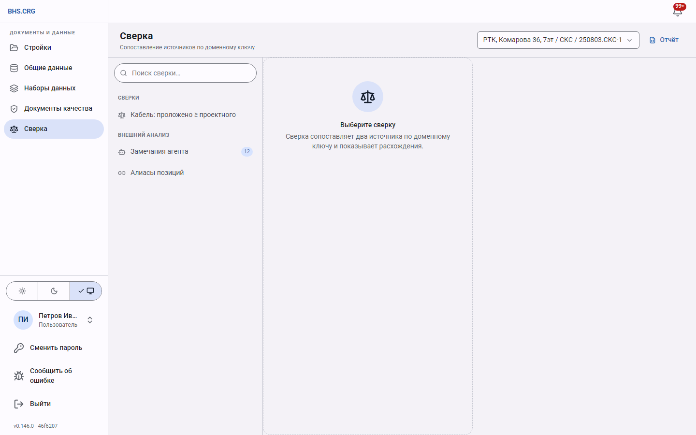

### 7.2. Прогон и находки

Кнопка **«Запустить»** выполняет сверку и сохраняет **прогон**. Каждая строка результата — находка
с одним из состояний:

| Состояние | Значение |
|---|---|
| Совпадает | значения сошлись в пределах допуска |
| Расхождение | не сошлись |
| Нет слева / Нет справа | строка есть только на одной стороне |

Прогоны копятся, поэтому результат можно сравнить с предыдущим. Если прогон завершился неудачей,
у него **всегда указана причина** — пустой список находок без неё читался бы как «расхождений
нет», а это самое опасное недоразумение в сверке.

### 7.3. Что делать с находкой

- **Признать нормой** — расхождение объяснимо (например, технологический запас). Находка перестаёт
  требовать внимания, решение сохраняется и переносится на следующие прогоны.
- **Исключить из сверки** — строку сравнивать не нужно вовсе.
- **Синонимы** — если один и тот же материал назван в источниках по-разному, свяжите названия
  синонимом. Система предлагает синонимы сама; предложение нужно подтвердить, и дальше оно
  применяется автоматически.

Решение привязано не к прогону, а к самой позиции, поэтому следующий прогон помнит, что уже
разобрано.

### 7.4. Замечания внешнего анализа

Отдельная панель — **журнал замечаний**. Это утверждения внешнего ИИ-агента, а не результат
проверки системой: у каждого замечания видно происхождение, и его нужно просмотреть
человеку. Не путайте их с находками сверки — те посчитаны по вашим данным детерминированно.

### 7.5. Отчёт

**Отчёт о расхождениях** выгружается в Excel и собирается **по комплекту документов** — так же,
как его сегодня ведут вручную: выберите комплект и нажмите выгрузку.

---

## 8. Документы качества

Библиотека сертификатов соответствия, деклараций, паспортов и отказных писем,
сгруппированная по производителям.

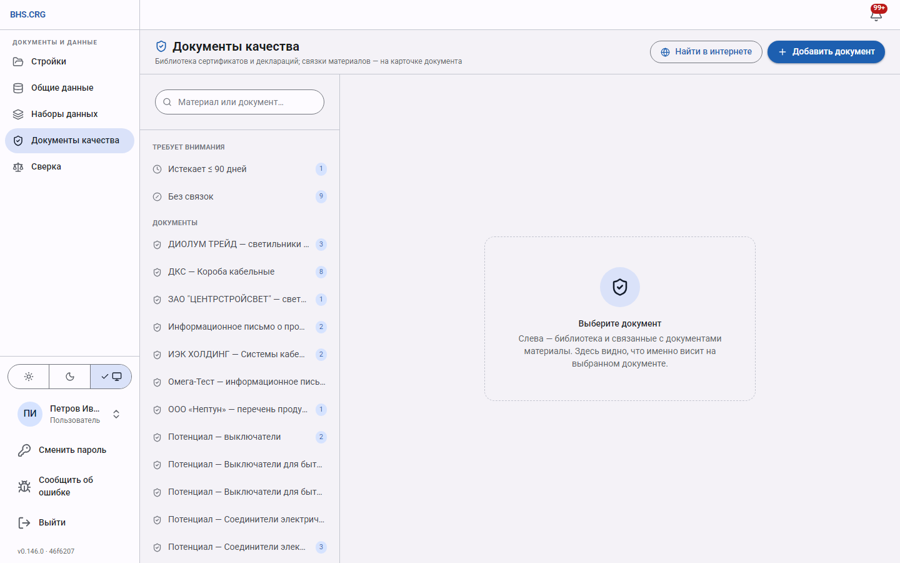

Возможности:
- **Добавить документ** — загрузить скан; реквизиты можно распознать автоматически.
- **Поиск документов в интернете** — найти документ по описанию материала и добавить в
  библиотеку (если настроен веб‑поиск).
- **Привязка к материалам** — выполняется на вкладке «Документы качества» в самом документе
  (раздел 4.5). Привязки автоматически применяются ко всем документам, где встречается
  тот же материал.

---

## 9. Уведомления и фоновые задачи

Справа вверху — **кнопка активности**: одна дверь и к тому, что сейчас выполняется, и к тому, что
уже случилось. Пока фоновых задач нет, это колокольчик; цифра на нём — число непрочитанных
уведомлений. **Красная** цифра значит, что среди непрочитанных есть сообщение об ошибке.

Щелчок открывает панель: сверху — **«Выполняется»** (когда задачи есть), под ним — **«Уведомления»**.
Уведомление со ссылкой открывает то, о чём оно: экран, файл или задачу в трекере разработки.

Когда что-то в системе не в норме — сервис отвечает через раз или недоступен, — над уведомлениями
появляется строка **«Состояние системы»** с тем, что именно. Щелчок по ней раскрывает весь список
сервисов. Когда всё в порядке, строки нет.

**Список у каждого свой.** Часть уведомлений общие для всех — о состоянии системы, об обновлении;
но прочитанным, скрытым крестиком или очищенным кнопкой **«Очистить все»** оно становится **только
у вас**. У коллег остаётся как было.

**Долгие операции идут в фоне.** Сборка комплекта и распознавание сканов не держат экран: колокольчик
превращается в пилюлю с вращающимся кольцом и названием задачи (если задач несколько — их числом),
а число новых уведомлений остаётся на ней же. В панели у каждой задачи видно, сколько она идёт;
задачу, которая ещё ждёт очереди, можно отменить крестиком. Экран можно закрыть, работа продолжится,
а о завершении придёт уведомление.

> Пилюля показывает **ваши** задачи. Если система перезапускается (обновление, перезагрузка
> сервера), незавершённые задачи обрываются и сами не возобновляются — их запускают заново.

---

## 10. Сообщить о проблеме

В меню аватара (справа вверху) есть пункт **«Сообщить о проблеме»**. Он открывает форму, не уводя
с текущего экрана, — несохранённое не потеряется. Форма — не только про сбои: «работает не так, как
ожидал» — тоже сообщение.

Заполнить нужно одно поле — «Что произошло». Полезнее всего три строки: что делали, что
ожидали, что получили.

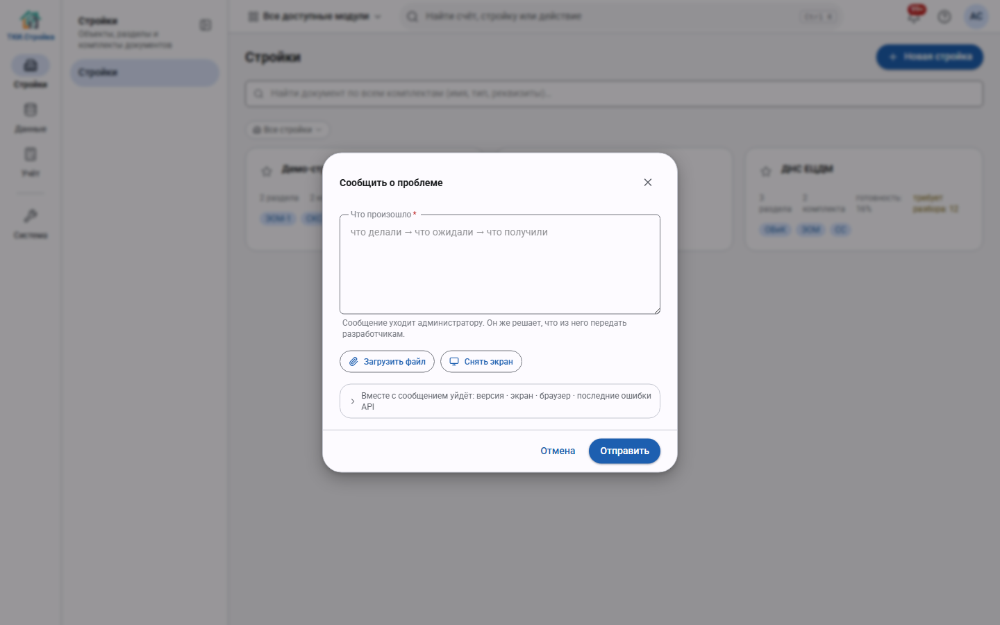

Форма открывается ещё из двух мест, и оба приносят с собой то, что вы не перепечатаете:

- кнопка **«Сообщить об ошибке»** на экране сбоя («Что-то пошло не так») — она стоит
  ПЕРЕД «Перезагрузить страницу» намеренно: после перезагрузки подробности сбоя пропадают;
- кнопка **«Сообщить»** на красном всплывающем уведомлении об ошибке — оно живёт несколько
  секунд, а идентификатор запроса из него нужен, чтобы найти запись в журнале.

**Снимок экрана.** «Загрузить файл» — приложить готовую картинку; «Снять экран» — снять её
прямо из браузера (кнопка есть не везде: браузер даёт снимать экран только на защищённом
соединении). Браузер спросит, чем поделиться, и предложит вкладку с приложением — соглашайтесь:
снимок вкладки содержит только страницу. Снимок экрана целиком принёс бы поверх неё служебный
интерфейс самого браузера — окно выбора и полосу «предоставляется доступ к экрану», — а она
ложится ровно на то, о чём вы сообщаете. Снимок показывается в форме до отправки — посмотрите, не попало ли в кадр
лишнее, и при необходимости нажмите «Убрать».

**Что уходит вместе с сообщением** перечислено в форме свёрнутым списком: версия, экран,
браузер, размер окна и последние ошибки обращения к серверу (только адрес, код ответа и
идентификатор запроса). Содержимого форм и ответов сервера там нет.

Сообщение получает администратор — он решает, что из него передать разработчикам, и убирает
внутреннее: репозиторий разработки открыт для всех. Снимок экрана наружу не передаётся
никогда. О решении вы узнаете уведомлением в колокольчике: «передано разработчикам (#N)» со ссылкой на
задачу, «исправлено в версии …» либо «отклонено».

---

## 11. Профиль

Пилюля с вашим именем внизу панели открывает **Профиль** — всё, что вы можете изменить о себе:

- **Фото** — «Загрузить фото» (PNG, JPG; изображение уменьшится само). Оно показывается в той же
  пилюле и рядом с вашим именем в системе.
- **Отображаемое имя** — как вас видят остальные. Меняется полем и кнопкой «Сохранить».
- **Email** — адрес входа. Рядом показано, подтверждён он или нет; **«Отправить письмо»**
  присылает письмо с подтверждением. Пока адрес не подтверждён, наверху висит напоминание — это
  не запрет: система работает как обычно, и письма (включая ссылку на смену забытого пароля)
  уходят на указанный адрес в любом случае. Подтверждение доказывает обратное: что адрес
  действующий и принадлежит вам. Стоит пройти его заранее — если в адресе опечатка, выяснится
  это иначе только в тот раз, когда письмо действительно понадобится.
- **Смена email** — новый адрес и текущий пароль. Система пришлёт письмо **на новый адрес**;
  адресом входа он станет только после перехода по ссылке из письма.
- **Смена пароля** — кнопка **«Сменить пароль»** здесь же (в профиль ведёт пункт **«Профиль и
  пароль»** меню аватара): текущий
  пароль, новый и подтверждение. Требования к новому: **не короче 8 символов, буквы верхнего и
  нижнего регистра и хотя бы одна цифра**.
- **Оформление и язык** — тема (светлая, тёмная, авто — как в системе; тему можно сменить и в
  меню аватара) и язык, которым система
  показывает даты и числа. Обе настройки хранятся в вашей учётной записи, а не в браузере:
  выбранное приедет на любой компьютер, где вы войдёте. Язык действует на **все** экраны сразу:
  суммы, количества и даты в счетах, накладных, реестре, отчётах и журналах пишутся так, как
  показано в предпросмотре под выбором. Язык меняет **показ**, а не ввод: в поле ввода число
  пишется без пробелов между разрядами и с запятой («1250,5») при любом языке, и набирать его
  надо так же — с запятой или точкой, без разделителей тысяч. Дату в поле документа тоже
  набирают одинаково, как `ДД.ММ.ГГГГ`.
- **Рабочее пространство** — с какого пространства начинать работу после входа (раздел 2):
  одно из пространств или **«Последнее выбранное»**. Блок есть, только если вам доступно больше
  одного модуля.
- **Избранные стройки** — список строек с галочками: отмеченные показываются во всех списках,
  остальные скрываются (раздел 3.2). Галочка сохраняется сразу; **«Снять все»** очищает избранное.
- **Мои права** — что открывают выданные вам роли, словами и по группам. Список показывает то,
  что вам **выдано**; чего в нём нет — того у вас нет. А какое именно право нужно недоступному
  разделу, называет сама страница отказа при попытке его открыть. Изменить права может только
  администратор — здесь они только для чтения.

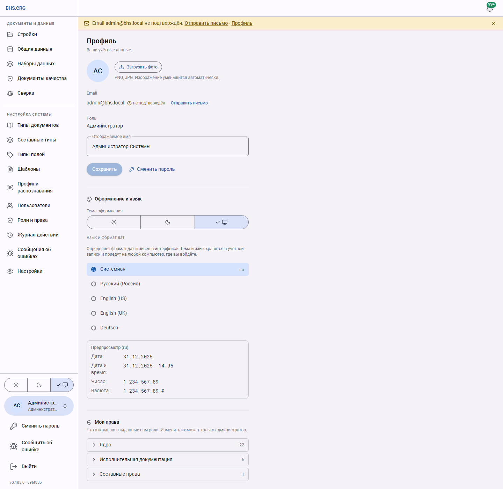

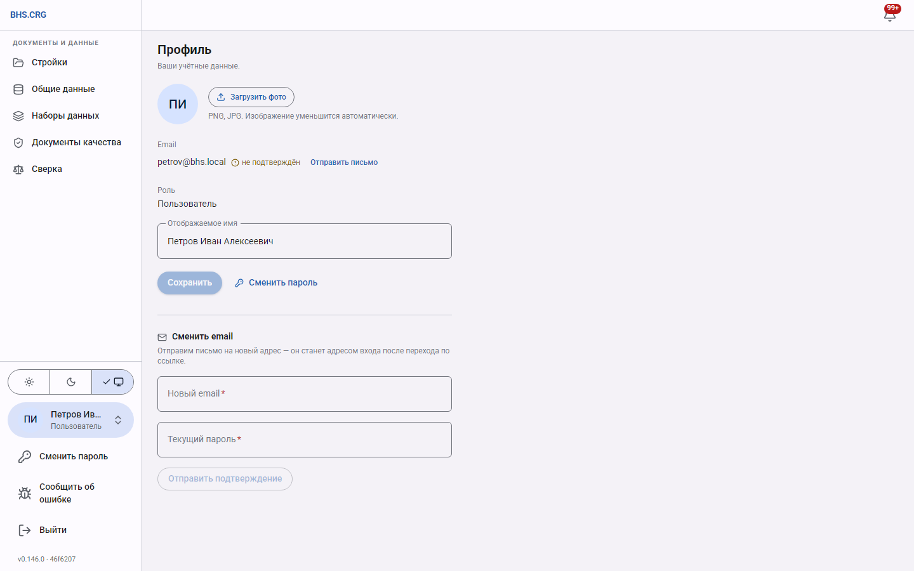

---

## Счета и накладные: быстрый старт

Типовые сценарии модуля «Счета и накладные» — шаги по порядку и ссылки на подробные разделы. Все
страницы модуля — в разделе **«Учёт»**: «Счета», «Накладные», «Реестр счетов», «Затраты по стройке»,
«Учётный период». Кто что делает, решают права: обычно снабженец вводит и разносит счета, бухгалтер
отмечает оплату и закрывает месяц.

### Сценарий 1. Счёт поставщика: от файла до затрат

**Счёт из файла → проверка → позиции → объект → «Разобран» → оплата → затраты**

1. **«Учёт» → «Счета» → «Счёт из файла»** — выберите PDF, скан, Excel или Word. Черновик появляется
   сразу, файл читается в фоне (раздел 13.4). Без файла — кнопка «Новый счёт».

   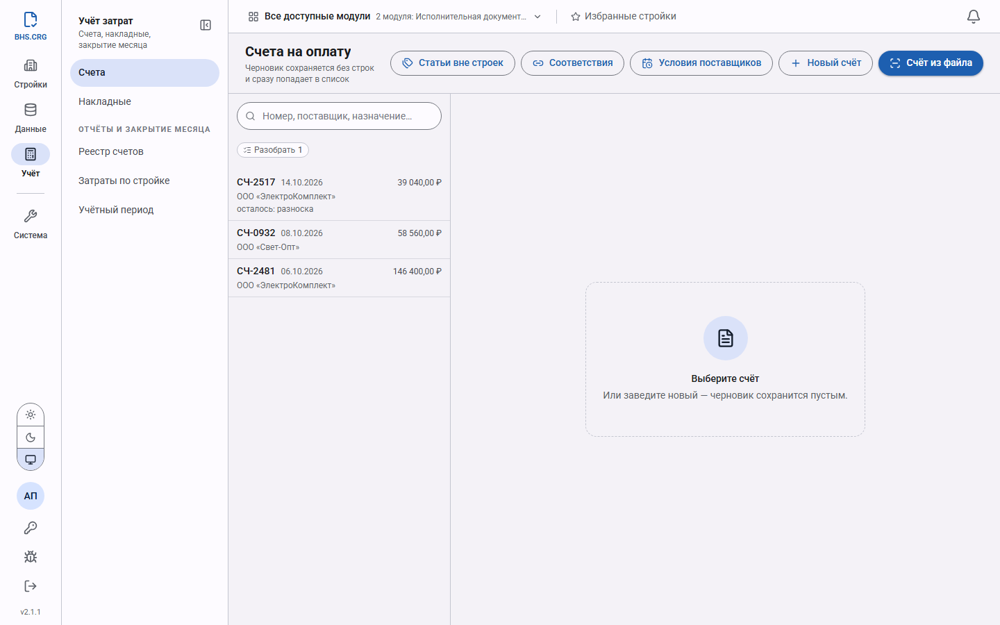

2. **Сверьте прочитанное с файлом справа.** Поля, вписанные распознаванием, обведены и подписаны
   «Распознано, не подтверждено» — проверьте их и нажмите **«Всё верно»** у блока (раздел 13.4).
   Поставщик и плательщик выбираются из справочника организаций.
3. **Строки счёта.** Каждой строке нужна **позиция номенклатуры**. Позиции, которые вы уже выбирали
   для этого поставщика, подставятся сами (раздел 13.5); позицию, которой в справочнике нет, можно
   завести прямо из строки (раздел 13.6). Строки можно вставить из Excel кнопкой «Вставить из буфера».
   Под таблицей — сверка: сумма строк против суммы к оплате.
4. **Разноска — на какой объект пошли деньги.** Весь счёт на одну стройку — поле **«Объект»** в шапке.
   На несколько строек — **«на несколько объектов»**: матрица разноски. Строку по отдельности —
   колонка «Разноска» в таблице строк.
5. **«Разобран».** Строка **«До „Разобран“ осталось: …»** под кнопкой называет всё, чего не хватает, —
   каждый пункт ведёт к своему месту формы (раздел 13.9).

   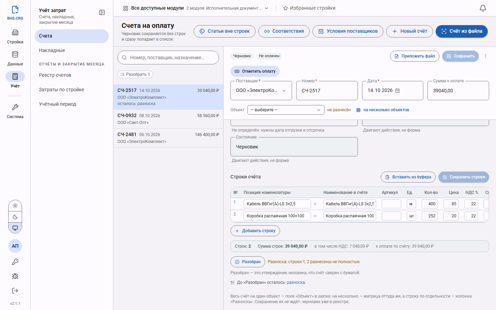

6. **Оплата** — бухгалтер нажимает **«Отметить оплату»** и указывает дату платежа и платёжный
   документ (раздел 13).
7. **«Учёт» → «Затраты по стройке»** — оплаченный счёт вошёл в затраты стройки за свой учётный месяц
   (раздел 14).

   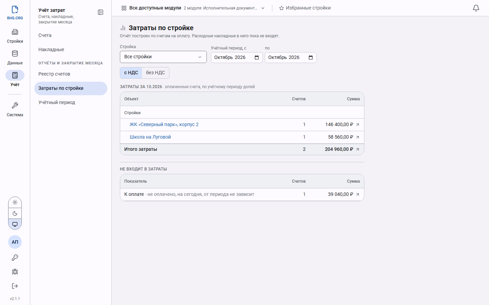

### Сценарий 2. Выдать материалы со склада на стройку

**Новая накладная → строки → «Провести» → материалы на объекте**

1. **«Учёт» → «Накладные» → «Новая накладная»** (раздел 15).
2. Шапка: номер, дата отпуска, склад, **стройка-получатель** и кто принял.
3. **«Добавить строку»**: позиция номенклатуры, наименование, как оно стоит в накладной, единица и
   количество. Возврат со стройки — отрицательным количеством.
4. **«Провести»** — материалы выданы на стройку. Чего не хватает для проведения, система называет
   поимённо.
5. **«Материалы на объекте»** — что выдано на стройку. Строки без позиции номенклатуры туда не
   попадают; найти их — отбор **«Только „Сопоставить“»** в списке накладных.

   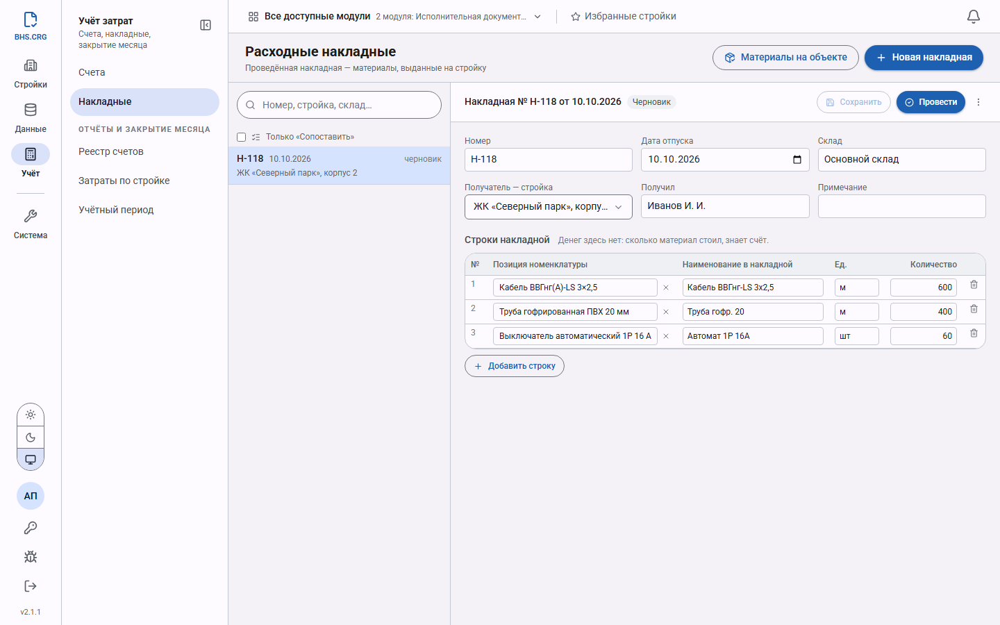

### Сценарий 3. Закрыть месяц

1. Разберите и оплатите счета месяца. Отбор **«Разобрать»** над списком счетов показывает, что ещё
   ждёт разбора; **«Реестр счетов»** — все счета с отбором по месяцу и объекту (раздел 6.7).
2. **«Учёт» → «Учётный период»** — закройте период по нужную дату. Диалог закрытия покажет, что в
   периоде не завершено; закрыть это не мешает (раздел 12).
3. После закрытия оплаченные счета периода заперты. Исправить такой счёт можно только исправлением
   с причиной (раздел 13.1).

---

## 12. Учётный период

Раздел **«Учётный период»** виден тем, у кого есть право «закрывать учётный период» (обычно
бухгалтер и менеджер проекта). Здесь задаётся граница закрытого учёта — до какой даты месяц
считается сведённым.

Закрытый период **запирает оплаченные счета**, деньги которых в него вошли, а оплата «задним числом»
в закрытый месяц переносится в первый открытый день — подробно в разделе 13.

**Закрыто — «по дату включительно».** У компании и у каждой стройки одна дата: закрыто всё до неё.
Поэтому периоды закрываются подряд, без пропусков: следующий начинается на другой день после
закрытого, и система подставляет это начало сама. Начало называете вы только при самом первом
закрытии — и всё, что раньше него, закроется тоже.

**Под фильтром «Избранные стройки»** (раздел 3.2) в таблице — компания и избранные стройки. Над
таблицей стоит отбор «Стройки» со «скрыто 11», а в заголовке колонки «Контур» написано, сколько
строек видно («3 из 14 строек»). Скрыта только строка таблицы: закрытие компании, отмена закрытия, перечень в
диалоге и история касаются всех строек, как без фильтра, — и диалог закрытия компании говорит это
прямо: «все стройки — 14, в том числе 11, скрытых фильтром избранного». Так же диалог отмены
закрытия компании называет, скольким стройкам откроются дни и сколько из них скрыто.

**Компания и стройка.** Закрытие компании закрывает все стройки разом. Стройку можно закрыть и
дальше компании — например, когда по ней месяц уже сведён, а по остальным нет. В таблице у такой
стройки стоит своя дата; у остальных — дата компании с пометкой «закрытием компании».

**Закрыть можно только прошедшие дни.** «Сегодня» считается по часам компании (их задаёт
администратор в настройках) и показано в шапке раздела; собственный часовой пояс стройки здесь не
учитывается.

**Что покажет диалог закрытия.** Под датами — раздел на каждый включённый модуль учёта:

- серой строкой — **по какой дате модуль относит документ к периоду** (счёт — по учётному периоду
  оплаты, см. раздел 13; расходная накладная — по учётной дате, которую получает при проведении);
- **«Не завершено — закрытию не мешает»**: например, «Оплачены в периоде, но не разнесены или не
  разобраны: 3 счёта на 412 500,00 ₽». Сумма — деньги этих счетов в периоде, а не только
  неразнесённая их часть. Закрыть период это не запрещает, но после закрытия разобрать или доразнести
  эти счета можно будет только исправлением с причиной (раздел 13.1). «Не разнесён» — это остаток, чья учётная дата
  попадает в закрываемые дни: остаток, перенесённый в следующий месяц, сюда не идёт. У стройки строка
  говорит только о неразобранных: неразнесённый остаток лежит на компании;
- **«Войдёт в закрытый период»**: оплаченные счета, деньги которых попали в закрываемые дни. За целые
  месяцы это то же число, что итог отчёта «Затраты по стройке» за них. Неоплаченных счетов здесь нет:
  они не относятся ни к одному периоду. После закрытия эти счета меняются только с причиной —
  исправлением или отменой оплаты. Если запрётся счёт, которого среди вошедших нет (доля без суммы или
  счёт, названный только корректировками), это названо отдельной строкой «Дальше — только
  исправлением с причиной»;
- там же — **«Корректировки закрытых периодов, сделанные в эти дни»**: разница от исправлений, отмен
  оплаты и смены допуска у счетов, чей период уже закрыт (раздел 13.1). Сами счета относятся к своим
  периодам, а разница ложится днём записи — и войдёт в закрываемый период. Поэтому сумма строки бывает
  нулевой и даже отрицательной (например, оплату запертого счёта отменили — поправка легла днём
  отмены). У счёта, который исправляли, его собственные деньги этих дней идут в «вошедшие в период», а
  поправка — сюда: один счёт бывает в обеих строках. Счёт, чью оплату отменили и не вернули, во
  «вошедших» не числится — он не оплачен, — и его деньги этих дней тоже здесь. Вместе две строки дают
  то, что эти дни покажут, пока закрыты («Затраты по стройке» на момент закрытия). Ссылки в реестр у
  строки корректировок нет: реестр показывает счета такими, какие они сейчас.

**Накладные в перечне** идут после счетов, числом документов — денег накладная не несёт:

- в «Войдёт в закрытый период» — **«Проведённые накладные, вошедшие в период»**: те, чья учётная дата
  попадает в закрываемые дни. После закрытия их нельзя вернуть в черновик, править и сопоставлять;
- в «Не завершено» — **«Проведены в периоде, но есть строки без позиции номенклатуры»**: такие строки в
  «Материалы на объекте» не попадают, а после закрытия сопоставить их будет нельзя. Хотите, чтобы
  перечень материалов за месяц был полным, — сопоставьте строки до закрытия;
- там же — **«Не проведены, а проведённые сейчас вошли бы в период»** — черновики накладных. Сюда
  идёт и черновик с датой отпуска в уже закрытом месяце: проведённый сегодня, он лёг бы в первый день
  закрываемого периода. Закрытие черновики не запирает, но проведённый после закрытия черновик ляжет в
  первый открытый день, а не в этот период.

Закрывая стройку, вы видите только её накладные; закрывая компанию — накладные всех строек и черновики
без стройки. Ссылки у строк накладных нет: экран накладных отбора по периоду не знает.

Считаются только дни, которые закрываются **впервые**: уже закрытое второй раз в перечень не идёт.
Это верно и для стройки, закрытой своим закрытием дальше компании: закрывая компанию, её счета за уже
закрытые дни вы в перечне не увидите — и итог тогда меньше, чем у отчёта «Затраты по стройке» за те же
месяцы, ровно на них.

**Суммы видит тот, у кого есть право на отчёты по затратам.** Остальным показано число документов и
сказано, что суммы скрыты.

**Число со стрелкой — ссылка в реестр счетов**, в новой вкладке: там перечислены сами счета, и итог
«Суммы» равен числу строки. Ссылка есть у строки «Оплаченные счета, вошедшие в период» и только когда
закрываются **целые месяцы**, с первого по последнее число: реестр отбирает счета по учётному месяцу и
за неполный показал бы больше. Поэтому её нет у первого закрытия (вместе с ним закрывается всё, что
было раньше), у периода из неполного месяца и при закрытии компании, когда какая-то стройка уже
закрыта дальше неё. Нет её и тогда, когда реестр перечислил бы не столько счетов, сколько в строке:
например, у стройки, чья доля в каком-то счёте легла в другой месяц, когда то же название носит
ещё одна стройка или статья, или когда в этих днях лежит счёт, исправленный после закрытия: строка
считает его так, как покажет закрытый период, а реестр — таким, какой он сейчас. В последнем случае
причина названа в пояснении строки. У строки «Не завершено» ссылки нет: такого отбора у реестра нет.

Рядом с кнопкой повторено главное — **«Не завершено: 3 счёта»**; то же скажет сообщение об успешном
закрытии.

Перечень считается заново при смене дат; пока он считается, кнопка «Закрыть период» недоступна.
Если, пока диалог был открыт, кто-то оплатил или поправил счёт, система ответит **«данные
изменились»** и покажет перечень заново, а у изменившихся строк — пометку **«было: …»** с прежним
числом: закрывается всегда то, что вы видели. Если числа на экране остались прежними, диалог скажет
об этом отдельно: изменилось то, чего вам не видно, — например, суммы, скрытые правом. Показанный перечень
сохраняется вместе с записью о закрытии: в **«Истории»** у такой записи есть строка **«Что показал
диалог при закрытии»** — она раскрывает тот же перечень с числами на момент закрытия (сейчас они
могут быть другими; суммы — по тому же праву; ссылок в реестр там нет). У закрытий, сделанных до появления перечня, сказано
«Перечень не записывался». В журнал действий попадает число незавершённых документов, без сумм.

**Закрыли не тот месяц** — нажмите **«Отменить закрытие»** в строке. Отменяется только последнее
закрытие, и причину нужно назвать: она останется в истории ниже и в журнале действий. Запись о
закрытии не стирается — рядом появляется запись об отмене. У стройки, закрытой закрытием компании,
кнопки нет: отменять нужно закрытие компании.

Отмена закрытия компании **не открывает** стройки, которые после него закрылись своим закрытием:
у стройки закрыто всё до её собственной даты. Диалог отмены называет такие стройки — их закрытие
отменяется отдельно.

> Если система отвечает «границу периода тем временем изменили» — период закрыл или открыл кто-то
> другой, пока раздел был у вас открыт. Обновите страницу и посмотрите, что изменилось.
>
> «Сейчас в учёт идёт запись» означает, что в эту минуту кто-то сохраняет документ. Период не
> изменён — повторите через минуту.

---

## 13. Оплата счёта

Оплату отмечает тот, у кого есть право «отмечать оплату счёта» (обычно бухгалтер), — кнопкой
**«Отметить оплату»** в шапке счёта. Счёт оплачивается **целиком, одним платежом, в одну дату**.

Тому, у кого права вводить счета нет (тот же бухгалтер), счёт открывается **только для чтения**:
в шапке так и написано, кнопок «Новый счёт», «Счёт из файла», «Сохранить» и действий над строками и файлом нет.
Оплата и разноска от этого не зависят — у каждой своё право.

**Что нужно назвать.** Дату платежа — по умолчанию сегодня по часам компании — и, если хотите,
платёжный документ («п/п № 45»); его можно дописать и позже. Дата раньше даты счёта допустима — это
предоплата. Дата в будущем — нет.

**Когда оплатить нельзя.** Причину система называет рядом с кнопкой и в самом диалоге:

- у счёта не указана сумма к оплате;
- сумма строк расходится с суммой к оплате больше допуска (по умолчанию 1,00 в валюте учёта; его
  задаёт администратор) — исправьте строки или сумму счёта.

У **отклонённого** счёта кнопки «Отметить оплату» нет вовсе — см. §13.7.

Пока в форме есть несохранённые правки, кнопка ждёт: оплата считается по сохранённому счёту.

**Уход из раздела с несохранёнными правками.** Если реквизиты счёта изменены, но не сохранены, а вы
щёлкаете пункт меню — другой раздел или сами «Счета», — система спрашивает: **«Сохранить и
перейти»**, **«Не сохранять»** или **«Отмена»** (остаться в счёте, правки на месте). Если сохранить
не удалось, переход не происходит, а причина названа сообщением — правки остаются в форме. При
закрытии вкладки и перезагрузке страницы предупреждает сам браузер.
⚠️ Выбор другого счёта в списке слева и кнопка браузера «Назад» не спрашивают — сохраните правки
до них.

**Учётная дата — у каждой стройки своя.** Деньги счёта входят в затраты не одним днём, а по разноске:
доля каждой стройки — датой платежа, если период этой стройки открыт, иначе **первым открытым её
днём**. Доли на статьи вне строек и то, что не разнесено, считаются по периоду компании. Диалог
показывает это **до сохранения** — таблицей «Когда войдёт в затраты»:

- переносов нет — одна строка: «Вся сумма войдёт в затраты 15.09.2026»;
- переносы есть — предупреждение «Переносится: 2 стройки, 140 000,00 из 500 000,00», причина по каждой
  стройке («у стройки закрыто по 30.09.2026 — войдёт в затраты с 01.10.2026») и кнопка **«Отметить
  оплату с переносом»**.

> Если система отвечает «расклад оплаты изменился, пока диалог был открыт» — за это время закрыли
> период, поправили разноску или сумму счёта. Оплата не записана; диалог показывает свежий расклад и
> подсвечивает изменившиеся строки. Проверьте и нажмите ещё раз.

**У оплаченного счёта** в шапке стоят дата платежа, платёжный документ (правится ссылкой
«изменить»), учётный период — «09.2026» или «09.2026 + 10.2026» — и ссылка **«расклад»** с той же
таблицей. Дату платежа не правят: её меняют отменой оплаты и новой отметкой.

**Оплаченный счёт можно править**, пока его периоды открыты, — но он обязан оставаться сведённым:
правка, после которой сумма строк разойдётся с суммой счёта, отвергается («сначала отмените
оплату»). При правке разноски доля, которая осталась на той же стройке, свою учётную дату сохраняет,
даже если сменился раздел: перенесённая в другой раздел или выделенная из прежнего раздела в новый,
она получает дату той доли, из которой взяты деньги. Так же у статей вне строек при переходе с одной
статьи на другую. Доля, перенесённая на другую стройку (или со стройки на статью), и новая доля,
деньги которой пришли с другой стройки, получают дату по тому же правилу, что при оплате.

**Отменить оплату** — «Отменить оплату» в шапке, с причиной: она останется в журнале действий.

### 13.1. Запертый счёт

Когда закрывают период, в который вошла **хотя бы одна** доля оплаченного счёта, счёт запирается
**целиком**: в шапке появляются плашка «Заперт» и полоса с причиной — «период закрыт по 30.09.2026 у
стройки …». Обычной правкой у такого счёта не изменить ни поля, ни строки, ни разноску — кнопок для
этого нет; изменить их можно **исправлением** (ниже).
Запирается весь счёт, а не одна доля, потому что копейки округления уходят в последнюю долю: правка
открытой доли изменила бы деньги закрытой.

**Платёжный документ** запертого счёта поправить можно: это текст, денег он не меняет.

**Отменить оплату** запертого счёта может тот, у кого есть и право отмечать оплату, и право
«Исправлять счета закрытого периода» (по умолчанию — у бухгалтера); остальным кнопки нет. Закрытый
месяц отмена не меняет: она записывается в книгу исправлений днём отмены, с причиной. После такой
отмены счёт **удалить нельзя** — только отклонить, — а когда его оплатят снова, он по-прежнему будет
правиться только исправлением.

Файл к запертому счёту **приложить можно**, если его ещё нет; **заменить нельзя** — прежний файл
документ закрытого периода.

**Исправить** запертый счёт может тот, у кого есть и право вводить счета, и право «Исправлять счета
закрытого периода» (по умолчанию — у бухгалтера); остальным кнопки нет. Закрытый месяц исправление не
меняет: его поправки записываются в книгу исправлений днём исправления.

1. **«Исправить»** в шапке переключает ту же форму в режим исправления: появляются полоса «Исправление
   закрытого периода» и поле «Причина исправления». Шапка и строки открываются для правки, разноску
   правят кнопкой «разноска по объектам» — в матрице «Готово» кладёт разноску в исправление, ничего не
   записывая. Всё, что записывается само, — файл, распознавание, «Ещё», «Разобран», выбор объекта, своя
   кнопка сохранения строк — в режиме скрыто: записывается всё одним исправлением.
2. **Причина** обязательна: она ляжет в версию счёта и в журнал действий. Без неё и без правок кнопка
   проверки не нажимается.
3. **«Проверить исправление…»** показывает, что запишется: день исправления, номер версии, которая
   уйдёт в историю, и строки книги со знаком — двумя группами: «Днём исправления» (поправки закрытого
   месяца) и «Своим днём» (период ещё открыт — поправка ложится туда, где лежали деньги). Если деньги не
   меняются (поправили номер или назначение), так и написано: запишутся только версия и причина.
   Служебные записи книги — открытие и выравнивание допуском — свёрнуты, раскрываются щелчком.
4. **«Записать исправление»** записывает ровно показанное. Если с проверки изменилось то, что ляжет в
   книгу (прошла полночь, закрыли период, сменили допуск), окно само пересчитает и попросит записать
   заново. Если счёт тем временем изменили, появится полоса «Счёт тем временем изменили» (раздел 13.2);
   если закрытие отменили — «Исправление больше не нужно — правьте как обычно».

«Поровну» и «по %» в матрице исправления доступны, пока строки не тронуты: их считает сервер по
записанным строкам. Новую строку разносят клетками матрицы. У кого нет права разноски, тот разноску в
исправлении не меняет — части уходят такими, какими были.

**История исправлений.** У счёта, который исправляли или у которого отменяли оплату после закрытия,
внизу формы появляется секция **«Исправления»** — её видит каждый, кому открыт счёт. В ней записи
книги исправлений, новые сверху: когда, кто, что (исправление с номером ушедшей версии, отмена или
новая оплата, выравнивание допуском, открытие книги — как деньги лежали до первой записи), причина,
день записи и итог — у исправлений со знаком. Открытие книги и выравнивание, сделанное заодно с исправлением, — служебные записи: в колонке «Кто» у них так и написано. Щелчок по записи показывает её строки: куда, каким днём и
сколько — так же, как в окне проверки исправления.

Другой путь — отменить закрытие периода (раздел 12) и править счёт как обычно. После отмены доли,
перенесённые в следующий месяц, **остаются в нём**: вернуть их можно, отменив оплату и отметив её
заново.

### 13.2. Счёт изменили, пока вы его правили

Один счёт могут открыть двое. Если, пока вы правили строки, поля или разноску, кто-то другой сохранил
свою правку той же части счёта, ваше сохранение **не пройдёт**: над формой появится полоса «Счёт тем
временем изменили». Набранное при этом остаётся на экране — ничего не пропадает.

Что делать: перенесите нужное себе (запишите, скопируйте), нажмите **«Перечитать счёт»** — форма
покажет то, что сейчас сохранено, — и внесите правку заново. Кнопка заменяет несохранённое сохранённым,
поэтому сначала перенесите, потом нажимайте.

Правки разных частей друг другу не мешают: если сосед поправил шапку, а вы правите строки, ваши строки
сохранятся как обычно. То же с кнопками «Разобран», «Вернуть в черновик», «Всё верно» и отметкой
оплаты: они относятся к тому, что вы видите, и если счёт с тех пор изменили, система попросит сначала
посмотреть на него заново.

### 13.3. Счёт ссылается на удалённую запись

Удалить запись справочника, на которую ссылается счёт, система не даёт (раздел 5). Но такая ссылка
всё же может появиться — после восстановления из резервной копии или если запись удалили в тот самый
момент, когда сохраняли счёт. Счёт при этом **не ломается и ничего не теряет**: он открывается, а на
месте значения стоит красная пометка — **«организация удалена»**, **«позиция удалена»**, **«стройка
удалена»**, **«раздел удалён»** или **«статья удалена»**.

В шапке счёта появляется сводка: в скольких местах стоят удалённые записи и где — «поставщик; позиция в
строках 3, 7; разноска строки 5». Она нужна потому, что сама пометка бывает за краем экрана — в строке под прокруткой.

Такой счёт **сохраняется как обычно**: можно править любые поля, строки и разноску, потерянные ссылки
при этом остаются на месте. Чтобы убрать потерю, выберите в поле другую запись или снимите значение.
Выбрать заново запись, которой нет, нельзя — система откажет и назовёт поле.

**«Раздел другой стройки»** — отдельная пометка: раздел существует, но принадлежит не той стройке, на
которую легла часть разноски. Так же отдельно помечена **запись «другого вида»** — она есть, но больше не
позиция номенклатуры, не статья или не организация. Это не удалённые записи; исправляются выбором заново.

У счёта закрытого периода сводка говорит, что исправить ссылки нельзя: в число потерянных такой счёт
не входит. Дополнительные поля, которые администратор дописал в тип счёта, на удалённые записи не
проверяются.

**Как найти такие счета.** На странице «Счета», над списком, стоят кнопки-отборы — нажата может быть
одна, повторное нажатие отбор снимает:

- **«Разобрать»** с числом — все недоведённые счета, то есть черновики: и те, у которых строки ждут
  позиции, и те, где позиции подставлены, а не выбран плательщик или не сделана разноска. Чего не
  хватает, видно в строке счёта: «осталось: плательщик · разноска» (не поместилось — «ещё 2», весь
  перечень — подсказкой при наведении). «Готов к „Разобран“» — условия выполнены, осталось открыть
  счёт и нажать кнопку. Та же строчка стоит у черновиков и без отбора. Если черновиков больше
  двухсот, строчка стоит у двухсот последних правленых — у остальных её нет, пока счёт не откроют.
  Под этим отбором кнопка «Разобран» сама открывает следующий счёт списка (с последнего — первый;
  если набран поиск — следующий из найденных): сообщение называет оба номера и даёт кнопку
  «Вернуться», а разобранный остаётся в списке строкой «разобран» — по ней к нему можно вернуться
  и позже. Если в форме осталось несохранённое, счёт разбирается, но остаётся открытым; если
  разбирать больше нечего — об этом сказано. Так же ведёт к следующему и «Отклонить» — строка в
  списке тогда подписана «отклонён». Удаление черновика к следующему не ведёт. Без отбора счёт после
  «Разобран» и «Отклонить» остаётся открытым;
- **«Не распознано»** с числом — черновики с файлом, в которых ещё нет строк (раздел 13.4);
- **«Удалённые записи»** с числом счетов — счета, в которых стоит удалённая запись и которые можно
  исправить;
- **«В архиве»** с числом — счета в работе (не оплаченные и не отклонённые), в которых стоит запись,
  убранная в архив. Счёт верен;
  заменить запись стоит, если её убрали как дубль.

Кнопок с числом нет, когда таких счетов нет, и у того, кто счета не правит. Числа двух последних — те
же, что в строке «Навести порядок» над реестром счетов (раздел 6.7). Если числа посчитать не удалось,
вместо кнопок стоит «Отборы не посчитаны» — это не «таких счетов нет»; нажмите, чтобы повторить.

В строке списка рядом с поставщиком стоят значки с числом: красный треугольник — удалённые записи,
серая коробка — записи в архиве; подсказка называет места («поставщик · позиции: 2 · разноска: 1»).
Под отбором места написаны третьей строчкой. Число значка — ссылки, а не места формы: удалённая стройка
уносит и раздел, и одна часть разноски считается дважды.

Заменили запись и сохранили — число на кнопке уменьшается сразу, а строка открытого счёта **остаётся в
списке**, со словами «больше не в отборе», пока вы с него не уйдёте. Счета закрытого периода в отбор не
входят: о них говорит строка внизу списка — исправить их нельзя, пока закрытие не отменят.

---

### 13.4. Счёт из файла

Кнопка **«Счёт из файла»** на странице «Счета» заводит черновик по файлу — PDF, PNG, JPEG, Excel или
Word. Черновик
с файлом появляется **сразу**, а файл читается в фоне: в шапке счёта стоит «Распознаётся…», в строке
списка — то же, пока у счёта нет номера, строка названа именем файла. Форму можно заполнять, не
дожидаясь; заменить файл, пока он читается, нельзя.

**Что за файл, система смотрит по его содержимому**, а не по имени: картинка, сохранённая как
«Счёт.pdf», остаётся картинкой, а текст с расширением `.pdf` счётом из файла не становится. Рядом с
формой открываются PDF и изображения (PNG, JPEG, GIF, WebP, BMP), а Excel и Word — видом для чтения
(о нём ниже); их и предлагает выбор файла у «Приложить файл». У файла другого вида в панели стоит «показать его здесь нечем» и кнопка
**«Скачать»** вместо «Во весь экран»; распознать такой файл тоже нечем. Если же панель пишет, что
чем показать файл, выяснить не удалось, — дело в связи с сервером, а не в файле: нажмите
**«Повторить»** или скачайте файл.

**Показать и распознать — не одно и то же.** Распознаются PDF, PNG, JPEG, Excel и Word. GIF, WebP и
BMP рядом с формой открываются, но не распознаются — кнопка «Распознать» у такого счёта так и говорит. Выбор файла у «Счёта из файла»
предлагает только то, что распознаётся.

**Счёт в Excel или Word** (`.xlsx`, `.xls`, `.docx`). Такой файл рядом с формой показывается не сам,
а **видом для чтения** — PDF, который из него строит система. Под именем файла так и написано: «Вид для
чтения — вёрстка может отличаться, документ — оригинал». Текст и числа в виде взяты из файла;
расположение, шрифты и разбивка на страницы — приближённые. Поэтому:

- **документ — тот файл, что вы приложили.** Кнопка **«Оригинал»** скачивает именно его; в закрытом
  периоде запирается и остаётся документом тоже он, а не вид;
- **распознаётся вид**, а не сам файл — так же, как распозналась бы распечатка этого счёта в PDF;
- под оговоркой могут стоять **пометки**: чем вид отличается от файла (например, сколько страниц
  вышло без текста). Если пометка говорит, что в вид попало не всё, — сверяйте счёт по оригиналу;
- **«Перестроить»** строит вид заново. Сам файл и уже распознанное при этом не меняются, но в шапке
  счёта появляется строка «Распознано по прежнему виду файла»: на экране теперь другая вёрстка, и
  сверять прочитанное с ней стоит внимательнее. «Распознать ещё раз» — там же.

Первое открытие счёта с файлом Excel или Word может занять до минуты: вид строится. Форму в это время
можно заполнять.

**Если вид не построен**, файл всё равно **приложен и скачивается** — прикладывать его заново не
нужно. Панель называет причину:

| В панели | Что это значит |
|---|---|
| «Вид для чтения не построен» и причина — файл защищён паролем, пуст, повреждён, слишком велик | дело в файле: показать и распознать его нельзя. Снимите пароль (или сохраните файл как PDF) и замените файл кнопкой «Заменить файл» |
| «Вид для чтения пока не построен» — конвертер недоступен или не настроен | дело не в файле: нажмите **«Повторить»** позже; если не проходит — скажите администратору («Состояние системы», строка «Конвертер офисных файлов») |

Из защищённого паролем файла `.xlsx` или `.docx` счёт кнопкой «Счёт из файла» не заводится — что внутри,
не видно, и система отвечает «файл другого вида». Заведите счёт вручную и приложите файл: причину
(пароль) назовёт панель.

**Что легло в счёт.** Прочитанное записывается только в пустые поля и только в счёт без строк. Каждое
такое поле обведено и подписано «Распознано, не подтверждено» — сверьте его с файлом справа и нажмите
**«Всё верно»** у блока (правка поля снимает метку с него сама).

**Что не легло — предложено.** Под полем, которое уже было заполнено, стоит «В файле: … · Взять»:
«Взять» кладёт прочитанное в поле, сохраняете вы. У даты и суммы кнопки «Взять» нет — впишите значение
сами. То же с полем, которое вы успели набрать, пока файл читался: на экране остаётся набранное.
Распознанные строки в счёт со своими строками не добавляются — об этом сказано в «Замечаниях
распознавания» над блоками формы; чтобы взять их, удалите свои строки и нажмите «Распознать ещё раз».

**НДС строк.** Если у строк в файле есть колонки «Ставка НДС» и «Сумма НДС», они ложатся в строки
счёта: «22 %» — ставкой 22, «Без НДС» — нулём; сумма НДС без своей колонки досчитывается по ставке.
Прочерк («-», «--») или крест «Х» в колонке НДС — пустая ячейка, а не ошибка чтения.
Если НДС стоит только в итогах файла («в том числе НДС …»), строки остаются без НДС, а НДС — в шапке;
сверка под строками так и пишет: «НДС по строкам не указан». Отчёты по затратам в этом случае берут
НДС из шапки.

- **НДС прочитан не у всех строк** (или у строки прочиталась ставка, а сумма НДС — нет) — в строки
  он не ложится **ни у одной**, и «Замечания
  распознавания» называют причину. Отчёты берут НДС шапки, только когда о нём молчат все строки:
  положи система НДС лишь части строк, остальные ушли бы в отчёт без вычета НДС. Прочитанное не
  потеряно — оно в примечании строки («НДС в файле: ставка 22 %, сумма 220,00…»; сумма, которую система
  досчитала бы по ставке, там не пишется — её в файле нет). Если НДС нужен по строкам, впишите его у
  всех строк.
- **Не прочиталось** (например, «20/120» вместо ставки) — значение не легло, а стоит в примечании
  строки «В файле не прочитано: …», как у остальных полей.

**Поставщик и плательщик** ищутся в справочнике по ИНН из файла. Под полем написано, что нашлось:

| Под полем | Что это значит и что делать |
|---|---|
| организация подставлена, «Распознано, не подтверждено» | найдена единственная — сверьте и подтвердите |
| «В файле: … · Взять» | найдена, но в поле стоит другая (или вы его очистили) |
| «Записей с этим ИНН: N · Выбрать» | в справочнике несколько разных записей — выберите нужную; архивные показаны, но не выбираются |
| «В справочнике нет · Завести» | организации с таким ИНН нет — её можно завести здесь же |
| «Есть в справочнике, но в архиве» | в новый счёт архивная запись не выбирается; верните её из архива в «Общих данных» |
| «Не найдена; справочник прочитан не весь» | у части записей ИНН не читается — они перечислены в «подробнее»; заводить новую нельзя, пока не проверены они |
| «ИНН прочитан с ошибкой» / «ИНН в файле не прочитан» | искать не по чему — выберите организацию вручную |

**«Завести»** открывает окно с названием из файла (его можно поправить) и ИНН (не правится). В справочник
попадают только название и ИНН — остальные реквизиты дополните в «Общих данных». Заведённая организация
ставится в поле, но **счёт сам не сохраняется** — нажмите «Сохранить». Если завести нельзя, причина
написана в том же окне. Кнопки нет у того, кому не выдано право заводить организации из счёта, —
попросите того, кто ведёт справочник.

**Если файл не распознан**, в шапке счёта стоит полоса с причиной: распознавание не настроено (счёт
заполняется вручную; движок настраивает администратор), движок не справился, в документе ничего не
прочитано, сам файл не читается, распознавание прервано. Поля такого счёта пусты не потому, что в
файле их нет. Кнопка **«Распознать ещё раз»** — там же; у счёта, к которому файл приложили вручную,
она называется «Распознать файл».

«Сам файл не читается» — это о файле, а не о распознавании: PDF повреждён, защищён паролем или это
вовсе не PDF, либо файл пуст. Такой файл в службу распознавания не отправляется, и кнопки «Распознать
ещё раз» у него нет: повтор ничего не изменит. Замените его исправным кнопкой «Заменить файл».

**Отбор «Не распознано»** над списком собирает черновики с файлом, в которых ещё нет строк: файл не
распознан, прочитан без строк или не распознавался. Какой из трёх случаев — написано в строке. Счёт
уходит из отбора, когда в нём появляются строки.

**Несколько файлов разом.** Кнопка «Счёт из файла» принимает и несколько файлов; их же можно
**перетащить на список счетов** (левую колонку) — пока файл тащат над окном, колонка обведена пунктиром.
На каждый файл заводится свой черновик. Правая часть экрана — открытый счёт — файлы не принимает:
файл открытого счёта заменяют кнопкой в его панели.

- Один файл открывает свой черновик, как и раньше. **Несколько файлов экран не двигают**: открытый
  счёт, отбор и поиск остаются как были.
- Над списком появляется полоса: «Загружаем файлы: 3 из 10» и кнопка **«Остановить»** — она даёт
  догрузиться текущему файлу и не отправляет остальные. Не закрывайте вкладку до конца загрузки.
- Итог остаётся в той же полосе, пока вы не закроете её крестиком: «Заведено 10 черновиков» либо
  «Заведено 7 из 10. Не принято 3:» — со списком файлов и причиной у каждого. **«Повторить
  непринятые»** отправляет ещё раз те, у кого повтор может кончиться иначе (сбой сервера, остановка);
  файл не того вида, пустой или больше 50 МБ повторять незачем.
- **Тот же файл дважды.** Если содержимое файла уже приложено к другому счёту, черновик всё равно
  заводится — в одном файле бывает несколько счетов, — а полоса называет такие файлы отдельным
  списком: «Уже были приложены — черновики всё равно заведены». Имя файла открывает новый черновик,
  название рядом — прежний счёт (без номера он назван именем файла и временем заведения до секунд).
  Счёт, удалённый тем временем — вами или соседом, — из этого списка уходит. Сравнивается содержимое,
  а не имя: переименованная копия — повтор, одноимённый файл с другим содержимым — нет. На форме
  такого счёта стоит оговорка «Этот файл уже приложен к другому счёту» со ссылкой и действием
  **«Загружен дважды — удалить этот черновик…»**; она остаётся, пока существуют оба счёта с этим
  файлом, и пропадает сама, когда один удалён или файл у него заменён. Удаления из полосы нет —
  лишний черновик убирают с формы. У разобранного, отклонённого и оплаченного счёта оговорка тихая,
  серой строкой, — кроме случая, когда совпали ещё и поставщик, номер и дата: тогда она жёлтая у
  любого счёта. Называется не больше десяти счетов с тем же файлом. Распознавание повторного файла
  идёт как обычно. Счета, заведённые до версии с этой проверкой, не сравниваются:
  отсутствие оговорки не значит, что файл новый. Один и тот же счёт в Excel и в PDF — разные файлы.
- **«Показать только их»** в полосе оставляет в списке одни счета этой загрузки. Список отсортирован
  по дате счёта: пока файл не прочитан, даты нет и черновик стоит наверху, а после распознавания
  переезжает на своё место между старыми счетами — без отбора их пришлось бы искать по одному.
  Действие появляется с первым заведённым черновиком, не дожидаясь конца загрузки; отбор-чип и поиск
  оно снимает. Под отбором полоса говорит «В списке только они: 5» — это число показанных счетов, а не
  заведённых: удалённый черновик из него уходит, разобранный и отклонённый остаются, поиск сужает
  внутри отбора, и число идёт за ним. Счёт, открытый в эту минуту, остаётся строкой списка, даже если
  заведён не этой загрузкой; в число он не входит. Снимают отбор
  «Показать все счета», любой чип над списком, крестик полосы и новая загрузка. Отбор **не
  сохраняется**: после перезагрузки страницы полоса на месте, и включить его — один щелчок; закрыли
  вкладку или полосу — счета этой загрузки останутся искать под отбором «Разобрать».
- Причина «ответ не пришёл — черновик мог завестись» значит ровно это: связь оборвалась, и завёлся ли
  черновик — неизвестно. Найдите файл в списке по имени, прежде чем повторять, иначе получите два
  черновика с одним файлом.
- Если сервер перестал отвечать или отказал так, что отказ был бы тем же для любого файла, загрузка
  **останавливается сама**: «Загрузка остановлена: …». Остальные файлы названы неотправленными — их
  отправит «Повторить непринятые».
- Если посреди загрузки завершился вход в систему, после повторного входа полоса покажет, что успело
  завестись и какие файлы не ушли. Повторить их кнопкой уже нельзя — выберите эти файлы заново.
- За один раз принимается **до 50 файлов**, каждый — до 50 МБ. Больший набор отвергается целиком,
  ничего не загружая: разделите его на части. Папки не раскрываются — перетаскивайте файлы из них.
- Как читается каждый файл, видно в строках списка и в разделе «Выполняется» кнопки активности — там у каждого
  файла своя задача, названная его именем. Что не распозналось, собирает отбор «Не распознано».

### 13.5. Запомненные наименования поставщика

Один и тот же кабель у трёх поставщиков называется по-разному. Чтобы не выбирать позицию номенклатуры
заново в каждом счёте, система **запоминает ваш выбор**: поставщик + его артикул (а если артикула в
строке нет — наименование) → позиция номенклатуры.

- **Запоминается при «Сохранить строки».** Пока строки не сохранены, у выбранной позиции стоит пометка
  **«запомнится»**; щелчок по ней называет, что именно запомнится, и даёт **«Не запоминать»** — для
  строк вроде «Доставка», которые всякий раз значат разное. После сохранения сообщение называет число:
  «Запомнено соответствий: 3».
- **Следующий счёт того же поставщика получает позицию сам.** Строке, которую вы набрали или вставили
  из буфера, запомненная позиция подставляется сразу. **Строкам, прочитанным из файла, — тоже сразу**,
  при распознавании: поставщика файл называет сам, по ИНН. Строкам, которые в счёте уже лежали, — кнопкой
  **«Подставить запомненное (N)»** над таблицей; она же пригодится счёту из файла, если поставщик в нём
  не узнан и вы выбрали его позже.
- **Подставленное помечено «запомнено».** Щелчок по пометке показывает, по чему строка узнана, когда и
  кем это запомнено. **Крестик рядом отменяет подстановку** в этой строке — без вопроса; до сохранения
  строк на том же месте стоит «вернуть». Само соответствие отмена не трогает.
- **Выбрали другую позицию — запомненное заменится.** Строка предупреждает заранее: «запомнится вместо
  прежнего». Если замена нужна только здесь — «Только в этой строке». Строки других счетов замена не
  переписывает; строка, подставленная по прежнему соответствию, скажет в своей пометке, что
  соответствие с тех пор направили на другую позицию.
- **Переписали наименование или артикул подставленной строки — подстановка снимается** вместе с
  позицией: запомненное относилось к прежнему тексту.
- **Регистр, лишние пробелы и «ё/е» строку не меняют**, а всё остальное меняет: «3х2,5» и «3х2.5» —
  разные наименования. Незнакомую строку достаточно разобрать один раз.
- **Позиция в архиве не подставляется** — пометка «запомненное в архиве» скажет об этом; выберите
  действующую позицию, и она заменит запомненное.
- **Нужен поставщик.** Пока поставщик у счёта не выбран и шапка не сохранена, подставлять не по чему, и
  выбор позиций в таком счёте не запоминается — об этом говорит строка над таблицей.

Запоминает и подставляет тот, кто вправе править счета. Новую позицию номенклатуры это не заводит
никогда: запомнить можно только выбор позиции, которая в справочнике уже есть. Завести её можно
отдельным действием — см. раздел 13.6.

**Список соответствий.** Кнопка **«Соответствия»** на странице счетов показывает всё запомненное: поставщик,
его артикул или наименование, позиция номенклатуры, когда и кем изменено. Туда же ведёт «Сменить или
забыть соответствие…» в раскрытии пометки «запомнено» — список откроется сразу на нужной записи.

- **Отбор** — по поставщику и по словам бумаги (артикул, наименование у поставщика). Под списком стоит
  «Показано 50 из N»: порция — не весь список; «Показать ещё» дочитывает следующую. Без отбора
  поставщики идут по алфавиту.
- **Сменить позицию** — щелчок по позиции в строке списка и выбор другой. Сохраняется сразу. В уже
  сохранённых счетах позиция не меняется; строка, подставленная раньше, скажет об этом в своей пометке.
- **Забыть соответствие** — корзина в строке, с подтверждением. Следующий счёт поставщика такую строку
  не узнает; в сохранённых счетах позиция остаётся.
- **Забыть все соответствия поставщика** — ссылка под списком, когда выбран один поставщик. Нужна,
  когда запись поставщика убирают из справочника (например, это дубль). Забывается всё, что у
  поставщика запомнено, а не только найденное поиском; вернуть забытое нельзя — подтверждение требует
  галочку.
- **Чипы «Позиция в архиве» и «Позиция удалена»** отбирают соответствия, которые больше не
  подставляются: смените им позицию либо забудьте.
- **Завести соответствие руками и поправить его артикул или наименование нельзя.** Это слова бумаги:
  набранные по памяти, они с ней не совпадут. Неверное забывают, верное запомнится само при первом же
  выборе позиции в строке счёта.

> **Соответствие держит поставщика и позицию от удаления.** Удалить из справочника организацию или
> позицию номенклатуры, для которых что-то запомнено, нельзя: система откажет и назовёт причину —
> «запомненные соответствия». Забудьте эти соответствия в списке (или смените им позицию) — и запись
> удалится. У поставщика их можно забыть все разом.

### 13.6. Новая позиция номенклатуры из строки счёта

Позиции в справочнике нет — её можно завести, не уходя со счёта. В окне выбора позиции внизу стоит
**«Завести новую позицию…»**; кнопка есть всегда, а не только когда поиск ничего не нашёл. Видит её
тот, у кого есть право вести справочник номенклатуры (у снабженца оно есть). Без права на её месте
сказано, что позиции заводит тот, кто ведёт справочник; строку можно сохранить и без позиции.

- **Вид** — «Номенклатура» или её подтип. Если отсюда можно завести только один вид, он уже выбран.
  Вид, у которого обязательно то, что коротким окном не заполнить (например, количество у
  «Материала»), отсюда не заводится — окно называет, какие поля мешают; такую позицию заводят в
  справочнике.
- **Поля** — те, по которым позицию отличают от других (обычно наименование, производитель, артикул),
  и обязательные. Наименование, артикул и единица подставлены из строки счёта. ⚠️ Наименование в
  счёте — это слова поставщика: назовите позицию так, как она должна стоять в справочнике. Код в счёте
  бывает внутренним кодом поставщика, а не артикулом изделия — тогда сотрите его.
- **«Похожие в справочнике»** обновляются по мере набора. Пока ответа о похожих нет — он ещё едет или
  сервер отказал, — кнопки создания нет: без проверки в справочнике появился бы дубль.
  - **«Такая позиция уже есть»** — все поля совпали с лежащей позицией (регистр и лишние пробелы не в
    счёт; пустое поле тоже считается). Вторую такую завести нельзя — нажмите «Выбрать». Если такая
    позиция в архиве, окно говорит об этом: вернуть её из архива может тот, кто ведёт справочник.
  - **Похожие** — позиции с тем же артикулом либо с большинством тех же слов в названии. «Это она»
    ставит лежащую позицию в строку. Не подходят — «Завести новую — похожие не подходят».
  - ⚠️ Сверка ищет совпадения слов и значений: написанное иначе («3х2,5» и «3*2.5») она не найдёт.
    «Похожих не найдено» не значит, что позиции нет, — сначала поищите её в окне выбора.
- **После создания** позиция стоит в строке; строки счёт сам не сохраняет. В справочник попало только
  названное в окне — остальные поля (группа, документ о качестве, изображение) дополняют в
  справочнике.

### 13.7. Отклонить счёт

Счёт, по которому решили **не платить**, отклоняют: в шапке формы меню **⋮ («Ещё») → «Отклонить…»**.
Диалог перечисляет, что изменится, и просит подтвердить.

Отклонённый счёт **остаётся в реестре** — с состоянием «Отклонён», со своими строками, разноской и
файлом. Это решение о настоящем документе: поставщик счёт выставил, и запись об этом должна остаться.
При этом счёт:

- не входит в затраты, в «К оплате» и в сроки оплаты;
- уходит из очереди «Разобрать», даже если у его строк не выбраны позиции;
- не оплачивается — кнопки «Отметить оплату» у него нет.

В списке счетов такой счёт помечен словом «отклонён».

**Передумали** — кнопка **«Вернуть в черновик»** под строками счёта. Счёт
возвращается черновиком со всем, что в нём было; если он был разобран, «Разобран» нажимают заново.

**Оплаченный счёт отклонить нельзя** — пункта в меню у него нет: его деньги уже вошли в затраты.
Сначала отмените оплату (§13), затем отклоняйте. Счёт, запертый закрытым периодом, не отклоняется по
той же причине — он оплачен.

Отклоняет и возвращает тот, кому можно вводить счета. Оба действия пишутся в журнал: «Счёт отклонён»
и «Счёт возвращён в черновик» — с тем, из какого состояния счёт ушёл.

### 13.8. Удалить счёт

Удаление — для счёта, **заведённого по ошибке**, и для **дубля**: не тот файл, один счёт введён
дважды. Настоящий счёт, по которому не платим, не удаляют, а отклоняют (§13.7) — он остаётся в реестре.

В шапке формы: меню **⋮ («Ещё») → «Удалить счёт…»**. Диалог называет счёт и поставщика, перечисляет,
что уйдёт, и просит подтвердить.

**Удаляется только черновик без оплаты.** У остальных счетов пункта в меню нет вовсе — сначала счёт
приводят к такому виду:

| Счёт | Что сделать перед удалением |
|---|---|
| разобран | «Вернуть в черновик» под строками счёта |
| отклонён | «Вернуть в черновик» под строками счёта |
| оплачен | отменить оплату (§13) — нужно право отмечать оплату |
| заперт закрытым периодом | он оплачен; сначала отменяют закрытие периода, затем оплату. Если оплату отменили при закрытом периоде, отмена записана в книгу исправлений — такой счёт не удаляется, только отклоняется |

**Удаление настоящее — корзины нет.** Вместе со счётом уходят его строки, разноска, файл счёта и
всё, что из файла прочитано. Вернуть счёт нельзя ничем, в том числе администратору; останется запись
в журнале действий «Счёт удалён» — с номером, датой, поставщиком и именем файла, без суммы. Запомненные
соответствия наименований поставщика остаются: они относятся к поставщику, а не к счёту.

Удалённый счёт можно завести заново — с тем же поставщиком, номером и датой.

Два коротких пути к тому же диалогу:

- в оговорке о дубликате — **«Это дубль — удалить этот счёт…»**; диалог первой строкой называет счёт,
  который останется;
- в оговорке о том же файле — **«Загружен дважды — удалить этот черновик…»**; диалог называет счёт,
  который останется с тем же файлом;
- в полосе «Файл не распознан: в документе не прочитано ничего» и «…сам файл не читается» — **«Не
  тот файл — удалить черновик…»**.

Файл счёта в эту минуту распознаётся — удалению это не мешает: прочитанное никуда не запишется.
Само чтение при этом может дойти до конца — задача в общем индикаторе завершится без ошибки.

Диалог предупреждает и о несохранённом на экране — правках полей и строк: они пропадут вместе со
счётом. Если счёт изменился, пока диалог был открыт (например, дочитался его файл), удаление
откажет и попросит посмотреть счёт заново.

**Счёт удалили, пока он был открыт у вас.** Форма не закрывается: над ней появляется полоса «Этого
счёта больше нет», набранное остаётся на экране — перенесите нужное. Сохранить такой счёт уже некуда;
«Закрыть счёт» убирает форму. Узнаёт об этом форма при первом же действии, при возврате в окно, а
если файл счёта в эту минуту распознавался — сама, в пределах пары секунд.

Удаляет тот, кому можно вводить счета: отдельного права на удаление нет.

**Связь оборвалась, пока счёт открыт.** Форма не закрывается и набранное не пропадает: над ней
появляется полоса **«Счёт не перечитался»** с причиной и кнопкой «Повторить». На экране при этом
прежнее состояние счёта — кто-то мог изменить его за это время. Сохранять можно: если счёт изменили,
сервер откажет и ничего не затрёт. Экран «Счёт не открылся» остаётся для счёта, который не удалось
открыть ни разу, и для случая, когда право видеть счета у вас сняли, пока счёт был открыт.

### 13.9. Чего счёту не хватает до «Разобран»

Под строками счёта, у кнопки **«Разобран»**, стоит строка готовности: **«До „Разобран“ осталось:
плательщик · 3 строки без позиции · разноска»**. Она называет **всё**, чего не хватает, — нажимать
«Разобран», чтобы узнать причину отказа, больше не нужно. Открыв чужой черновик, вы видите, на чём
остановился тот, кто вёл его до вас.

- **Пункт — ссылка.** Щелчок приводит к своему месту формы и ставит туда ввод: к полю шапки, к
  названной строке таблицы («позиции нет в справочнике: строка 37» — к строке 37) или к выбору объекта.
- **У разноски пунктов может быть несколько** — по одному на причину: «разноска» (не разнесены строки),
  «пересчёт разноски по строкам», «разноска на удалённую цель», «сумма строк расходится с суммой к
  оплате». Последний ведёт к полю суммы: выбор объекта расхождение не чинит.
- **Обязательные поля помечены звёздочкой**: номер, дата, поставщик, плательщик. Черновик сохраняется
  и без них — обязательны они для «Разобран».
- **Всё закрыто** — строка говорит «Всё готово к „Разобран“», а кнопка становится главной на экране
  (если в форме нет несохранённых правок: сначала сохраните их).
  «Разобран» остаётся вашим решением: это утверждение, что счёт сверен с бумагой.
- **Строка — о сохранённом счёте.** Пока в форме есть несохранённое, она об этом говорит: выбранный,
  но не сохранённый плательщик из перечня не уходит. Сохраните — строка обновится.
- **Пункт, на который у вас нет права**, виден, но ссылкой не является: например, «разноска» у того,
  кто вводит счета, но не разносит их. Перечень один для всех — счёт доводят разные люди.
- У разобранного и у отклонённого счёта строки нет. Нет её и у счёта, запертого закрытым периодом:
  такой счёт не правят вовсе, пока период не откроют.

Кнопка «Разобран» не отключается и при непустом перечне. Нажмёте — сервер откажет, объяснит первую
причину и перечислит остальные.

### 13.10. Срок «оплатить до»

Срок в блоке «Оплата» счёта **подставляется сам** — от **даты отгрузки** и **отсрочки в днях**. Правило
задаёт администратор (по умолчанию день отгрузки — первый день отсрочки: отгрузка 1-го, отсрочка 10
дней — оплатить до 10-го). Отсрочка 0 — оплатить в день отгрузки.

- **Когда подставляется.** При сохранении счёта, у которого изменились дата отгрузки или отсрочка.
  Правка других полей срок не трогает.
- **Без даты отгрузки или отсрочки** срок не определён — так и написано под полем. Срок, прочитанный
  из файла счёта, остаётся как прочитан — и при заведении счёта, — пока не изменят дату отгрузки или
  отсрочку; тогда его заменит посчитанный, а пометка «распознано» с поля снимется.
- **Свой срок.** Впишите дату и сохраните — под полем появится «Изменён вручную»: такой срок правило
  больше не меняет, даже если поменять отгрузку. Правка записывается в журнал действий отдельной
  строкой «Срок оплаты изменён вручную». Дата, совпадающая с посчитанной, ручной не считается.
- **Вернуть срок к правилу** — кнопка **«По правилу»** под полем. Она видна, когда нажатие что-то
  изменит: срок вписан вручную либо записан по прежнему правилу. Без даты отгрузки или отсрочки
  кнопки нет — возвращать не к чему. Пока в форме есть несохранённые правки, кнопки тоже нет —
  сначала сохраните.
- **Администратор сменил правило** — уже записанные сроки остаются прежними. Под полем такого счёта
  написано, что дало бы действующее правило; пересчитать — «По правилу».
- **Отгрузка раньше даты счёта** — под полем предупреждение: так бывает, но чаще это опечатка, и
  срок от неё уедет.

**Отметка в списке счетов.** У неоплаченного счёта со сроком в строке списка видно, сколько дней
осталось (**«12 дн.»**), в день срока — **«сегодня»**, после срока — красное **«просрочен»**. За три дня
до срока отметка становится жёлтой. Наведите на неё — увидите дату срока. У оплаченного и
отклонённого счёта отметки нет. «Осталось дней» и «Просрочен» считаются от сегодняшнего дня и нигде
не хранятся: никто их не ставит, а сдвиг срока сразу меняет отметку. Те же значения — колонками
реестра счетов (раздел 6).

### 13.11. Условия поставщиков

Отсрочку платежа можно записать за поставщиком — тогда её **получает счёт сам**, когда в нём выбирают
этого поставщика, и от неё считается срок «оплатить до».

**Где.** Кнопка **«Условия поставщиков»** на странице счетов (видна тем, кто вводит счета). В окне:

- **завести** — выберите организацию, укажите отсрочку в днях (0 — платим в день отгрузки) и нажмите
  **«Добавить»**;
- **изменить** — исправьте число в строке поставщика; сохраняется, когда уходите из поля или
  нажимаете Enter;
- **снять** — корзина в строке.

**Когда отсрочка подставляется.** При сохранении счёта, в котором **сменили поставщика** — в том числе
при первом выборе поставщика в новом счёте и когда поставщика узнало распознавание файла. Отсрочку,
вписанную вами, условия не перекрывают — даже если число совпадает с условиями прежнего поставщика:
подставляется только в пустое поле или поверх отсрочки, которую раньше подставили сами условия. Если
у нового поставщика условий нет, отсрочка в счёте остаётся как была — проверьте её. Отсрочка, которую
принёс поставщик, узнанный распознаванием, помечена «распознано, не подтверждено» вместе с ним.

**Под полем «Отсрочка»** написано, откуда она: **«Из условий поставщика»** либо **«В условиях
поставщика — 30 дн.»**, если в счёте другая.

> ⚠️ Правка и снятие условий **уже заведённые счета не меняют**: отсрочка и срок в них остаются, какими
> были. Новые условия получат только счета, в которых поставщика выберут после правки.

Пока у организации есть условия, удалить её из справочника нельзя — сначала снимите условия в этом
окне.

## 14. Затраты по стройке

Пункт **«Затраты по стройке»** в меню — отчёт: сколько денег вошло в затраты за выбранные учётные
месяцы. Виден тем, у кого есть право на отчёты по затратам (у бухгалтера оно есть).

> Отчёт построен **по счетам на оплату**. Расходные накладные в него пока не входят — об этом сказано
> под заголовком, и строки с нулём «по накладным» на экране нет нарочно.

**Что выбрать.** Вверху три параметра:

- **Стройка** — «Все стройки» (так отчёт открывается) либо одна;
- **Учётный период, с — по** — месяцами. Это те же учётные месяцы, что в колонке «Учётный период»
  реестра: доля счёта входит в затраты месяцем своей учётной даты, а не днём платежа (см. раздел 13);
- **с НДС / без НДС**.

Выбранное записано в адресе страницы: ссылку можно отправить коллеге, а кнопка «Назад» из реестра
возвращает отчёт в том же виде.

**Все стройки.** Строки — стройки, затем отдельной группой **«Вне строек»** (статьи: склад, общие
расходы) и, если есть, **«Не разнесено»** — деньги оплаченных счетов, не лёгшие ни на один объект.
Внизу **«Итого затраты»**: строки складываются в него без остатка. Щелчок по названию стройки
открывает отчёт по ней.

**Под «Избранными стройками»** (раздел 3.2) неизбранные стройки свёрнуты в одну строку первой в группе
«Стройки» — **«Скрыто фильтром: 11 строек»** с их суммой. Ни одно число при этом не меняется: итог —
по всем стройкам, и столбец вместе со свёрнутой строкой сходится с ним. Колонка «Счетов» у свёрнутой
строки пуста нарочно: счёт на двух стройках посчитан у каждой, и число счетов не складывается.
Стрелки в реестр у неё нет. **«Показать построчно»** раскрывает строки здесь же, не трогая отбор
«Стройки» в списках, и только для этого отчёта: другой период, НДС или стройка приходят снова
свёрнутыми. **«Свернуть неизбранные»** у заголовка группы сворачивает обратно. Группа «Вне
строек», «объект удалён» и «Не разнесено» видны всегда. Деньги на стройках и статьях, которых больше нет, стоят одной строкой
**«объект удалён»** — так же их называет реестр.

**Одна стройка.** Строки — контрагенты, включая «поставщик не указан». Переключатель **«по
контрагентам / по разделам»** (он появляется, когда стройка выбрана) раскладывает **ту же сумму** по
разделам стройки: итог один и тот же. Деньги, разнесённые на стройку целиком, стоят строкой **«без
раздела»**; на разделы, которых больше нет, — строкой **«раздел удалён»**. Разделы стройки, названные
одинаково, идут одной строкой: реестр отбирает раздел по названию и различить их не может. В срезе по разделам счёт,
разнесённый на два раздела, посчитан в колонке «Счетов» у каждого, поэтому числа счетов в итог не
складываются — складываются суммы.

**В затраты входят** оплаченные счета — деньгами, вошедшими в выбранные месяцы. Счёт, разнесённый на
две стройки, входит в каждую своей долей; счёт, доли которого закрытие периода развело по разным
месяцам, — в каждый месяц своей частью. В колонке «Счетов» такой счёт считается один раз. Счёт
считается в строке, только если его деньги в ней не ноль: после исправления, перенёсшего деньги с одной
стройки на другую, у первой не остаётся строки «1 счёт, 0,00». В итоге счёт считается, если он посчитан
хоть в одной строке объектов (на экране стройки — поставщиков), — поэтому нулевой итог при непустых
строках законен: это перенос. Разделы стройки — второй срез: перенос между разделами у того же
поставщика виден в строках разделов, а в итоге такой счёт не считается. Диалог закрытия периода считает
иначе — каждый счёт, который запрётся, и с нулевой суммой тоже.
**Отклонённые счета не входят никуда.**

**Стрелка у числа ведёт в «Реестр счетов»** с готовым отбором — там и видны сами счета. Итог колонки
«Сумма» в реестре равен числу, с которого вы пришли. У строки «Не разнесено» стрелки нет: отбора
«есть неразнесённый остаток» в реестре нет.

Под итогом — то, что входит в него, но требует внимания:

- **«из них без позиции номенклатуры: 3 счёта на 58 000,00 ₽ — в затраты вошли, в материалы нет»** —
  счета, в которых есть строки без позиции номенклатуры. Это часть итога, а не добавка к нему;
- под **«без НДС»** — **«НДС не указан: … — учтены полной суммой»**: НДС вычитается там, где он назван, —
  в строке счёта; а если строки счёта об НДС молчат все — берётся «в том числе НДС» из шапки. Где не
  назван, вычитать нечего, и деньги стоят как есть: «ставка не указана» не значит «без НДС». Так же
  идёт строка без НДС в счёте, где у других строк он указан: НДС шапки уже лежит в них. Под «без НДС»
  реестр по стрелке покажет суммы **с НДС** — об этом говорит подсказка у стрелки.

**«Не входит в затраты» — отдельным блоком.** В нём **«К оплате»**: неоплаченные и не отклонённые
счета (у стройки — их доли на неё). От периода это число не зависит: неоплаченный счёт не
принадлежит ни одному месяцу. Суммы «затраты и к оплате вместе» на экране нет — это разные вещи.
Под «без НДС» и здесь названо, сколько учтено полной суммой.

Период — в пределах календаря учётных месяцев: с января 2020 года по декабрь следующего. Месяц вне
его отчёт не строит и говорит об этом.

У строки **«поставщик удалён»** (организации счёта больше нет в справочнике) стрелки нет: отбора под
такие счета в реестре нет.

**Исправления после закрытия — два взгляда.** Если в выбранном периоде есть счета, исправленные после
закрытия (или с отменённой и заново поставленной оплатой), над таблицей появляется полоса **«Закрытые
периоды»**. Она говорит, чем взгляды различаются — итогами или, при равных итогах, разделами,
поставщиками и днями, — и называет итог другого взгляда. Переключатель в ней:

- **«С исправлениями»** — так отчёт открывается. Исправления учтены в тех месяцах, которые исправили;
  числа те же, что в реестре, и у всех стоят стрелки;
- **«На момент закрытия»** — закрытые месяцы такими, какими их закрыли, а исправления — корректировкой в
  месяце, когда их сделали. Стрелка в реестр остаётся только у тех чисел, которые с реестром сошлись:
  реестр показывает счета как они есть сейчас. Вместо «из них без позиции номенклатуры» здесь стоит
  **«Без позиции номенклатуры сейчас: 2 счёта — сумма и список во взгляде „с исправлениями“»**: позиции
  у строк счёта — сегодняшние, и сумма под итогом закрытия смешивала бы два времени. Щелчок по словам
  про взгляд переключает отчёт.

  Корректировки в этом взгляде видны отдельно. Корректировка — разница, которую исправление счёта,
  отмена его оплаты или смена допуска положили в открытый месяц, потому что закрытый месяц меняться не
  должен:
  - под итогом — **«включая корректировки закрытых периодов: 2 счёта, −30,00 ₽»**. Корректировки уже
    вошли в итог, это не добавка к нему; число бывает и отрицательным;
  - у строки, где деньги — одни корректировки, после названия стоит приглушённое **«· корректировка»**;
  - у строки, где есть и свои деньги, и корректировки, после названия — значок; подсказка у него
    называет корректировки строки;
  - у строки «Скрыто фильтром: …» — тот же значок, если корректировки есть у скрытых строек; подсказка
    называет их сумму без числа счетов: счёт на двух стройках посчитан в каждой.

  Корректировка считается по своим деньгам. Поэтому она может стоять под итогом и без строки: если
  исправление перенесло деньги счёта из закрытого месяца в открытый на ту же стройку, деньги счёта в
  строке — ноль (свои +30 и корректировка −30), и счёт в ней не считается. Если так вышло со всеми счетами
  периода, вместо таблицы стоит **«Затраты за период — ноль»**, а под ней — та же строка о корректировках.
  Новая оплата — не корректировка: она ложится в свой учётный день, даже если в тот же день раньше легла
  отмена оплаты. Корректировкой она становится в одном случае: её день — в месяце, который был закрыт, когда
  оплату отменили, а потом закрытие отменили. Закрытый тогда месяц хранит прежнее число.

Выбор записан в адресе страницы, как остальные параметры. Если взгляды не различаются, полосы нет.

## 15. Расходные накладные

Раздел **Накладные** (модуль «Счета и накладные», право «видеть расходные накладные»). Накладная —
отпуск материалов со своего склада на стройку. Права на счета этот раздел не требует и счетов не
открывает; **денег в накладной нет** — сколько материал стоил, знает счёт.

**Ввод.** «Новая накладная» заводит пустой черновик. В шапке — номер, дата отпуска, склад (названием,
как в бумаге), стройка-получатель и кто принял. Строки добавляются кнопкой «Строка»: позиция
номенклатуры из справочника, наименование, как оно стоит в накладной, единица и количество. Возврат со
стройки вводится отрицательным количеством. Черновик сохраняется кнопкой «Сохранить» и живёт сколько
нужно.

**Проведение.** «Провести» означает: перечисленные материалы выданы на стройку. Перед этим система
сама сохраняет набранное. Провести можно накладную, у которой есть номер, дата отпуска, стройка, хотя
бы одна строка и количество в каждой; чего не хватает, отказ называет поимённо.

**Несопоставленные строки.** Строку без позиции номенклатуры провести можно — материал выдан, и ждать
справочника незачем. Но в перечень «Материалы на объекте» такая строка **не попадает**, и об этом
сказано числом: «Не сопоставлено: 4 строки» — на самой накладной, в списке (значок с числом) и над
перечнем материалов. Отбор **«Только „Сопоставить“»** в списке показывает накладные, где такие строки
есть. Позицию можно выбрать и у проведённой накладной — она записывается сразу, возвращать накладную в
черновик для этого не нужно.

**Исправление проведённой.** Шапку и строки проведённой накладной не правят: её строки уже учтены в
перечне выданного. Чтобы исправить, нажмите «Вернуть в черновик», поправьте и проведите снова — оба
действия записываются в журнал.

**Накладная и закрытый период.** При проведении накладная получает **учётную дату** — обычно это дата
отпуска. Когда период этой даты закрывают (§12), проведённая накладная **запирается**: вернуть её в
черновик и выбрать позицию её строкам нельзя, кнопок для этого на форме нет, а вместо них стоит
строка «Заперта: период закрыт по … у стройки …». Перечень «Материалы на объекте» за закрытый месяц
после этого не меняется. Чтобы исправить такую накладную, сначала отмените закрытие периода.

Черновик не заперт никогда. Накладную, которую вводят **после закрытия** датой уже закрытого месяца,
можно завести, заполнить и провести: она ляжет в первый открытый день, а дата отпуска останется той,
что в бумаге. Форма говорит об этом строкой «Введена после закрытия периода: учтена …». Такая
накладная не заперта и исправляется как обычно.

**Если накладную изменили, пока вы на неё смотрели**, любое действие — «Сохранить», «Провести»,
«Вернуть в черновик», выбор позиции — получит отказ «тем временем изменили»: перечитайте накладную
и повторите.

**Материалы на объекте.** Кнопка над списком открывает перечень выданного на выбранную стройку: позиция,
количество, единица, даты отпуска и число накладных. Считаются только проведённые накладные; черновики в
перечень не входят.

**Несохранённые правки.** Если вы набрали что-то и не сохранили, система спросит, что с этим делать, —
и при выборе другой накладной, и при уходе из раздела. Если накладную тем временем изменил кто-то
другой, над формой появится предупреждение: набранное остаётся на экране, но сохранить его поверх
нельзя — перечитайте накладную и внесите правки заново.

Если связь оборвалась, пока накладная открыта, форма не закрывается: над ней появляется полоса
**«Накладная не перечиталась»** с кнопкой «Повторить», набранное остаётся на экране — как у счёта (§13.8).

В списке показаны самые свежие накладные (до 300); если их больше, список говорит об этом.

**Удалить накладную.** Накладную, заведённую по ошибке, удаляют: меню **«Ещё»** (три точки) в шапке
формы → **«Удалить накладную…»**. Удаляется **только черновик** — и **насовсем**: корзины нет, вернуть
накладную будет нельзя. Вместе с ней уходят её строки; в «Материалы на объекте» черновик не входил, и
там ничего не меняется. В журнале действий остаётся запись: номер, дата, склад, получатель и число
строк. Отдельного права нет — удаляет тот, кто вводит накладные.

У проведённой накладной пункта нет: сначала верните её в черновик. Проведённую накладную закрытого
периода вернуть в черновик нельзя — значит, нельзя и удалить, пока закрытие не отменено.

Если накладную тем временем изменили, удаление откажет — посмотрите её заново и решите ещё раз. Если её
уже удалил кто-то другой, вы увидите «уже удалена». Открыли накладную по старой ссылке, а её нет —
экран так и скажет: «Накладной нет: её удалили или ссылка неверна».

Если накладную удалили, пока она открыта у вас, форма не закроется: над ней появится полоса **«Этой
накладной больше нет»**, а набранное останется на экране — перенесите нужное себе. Сохранить его уже
некуда; «Закрыть накладную» убирает форму.

## 16. Частые вопросы

**Не вижу раздела «Система» — типов документов, шаблонов, параметров системы и т. п.**
Это разделы администратора. Роль «Пользователь» работает только с документами и данными.
Что открыто вам — видно в профиле, блок **«Мои права»** (раздел 11); чего не хватает конкретному
разделу, скажет страница отказа, если открыть его по ссылке.

**Куда делась кнопка «Сохранить» на вкладках «Документы качества», «Генерация» и «Источники данных»?**
Её там нет намеренно: действия на этих вкладках применяются сразу, сохранять нечего. Кнопки
сохранения показываются только на «Реквизитах».

**Где вкладки «Связи» и «Данные»?**
Их больше нет, и работа с ними никуда не делась: ссылки на записи каталога заполняются прямо в
реквизитах (раздел 4.3), а привязки к наборам данных — на вкладке **«Источники данных»**
(раздел 4.4).

**Документ не генерируется.**
Проверьте обязательные поля (со звёздочкой) на вкладке «Реквизиты».

**Забыл пароль.**
На экране входа нажмите **«Забыли пароль?»** — придёт письмо со ссылкой на смену (ссылка живёт
час и срабатывает один раз). Подтверждён ваш адрес или нет, значения здесь не имеет.

Письмо не пришло — посмотрите в папке со спамом, а если его нет и там, обратитесь к
администратору: система отвечает «письмо отправлено» одинаково всегда (чтобы по этому ответу
нельзя было проверять чужие адреса), поэтому со стороны не видно, была ли отправка. Причины,
которые устраняет только он: почта не настроена, не задан публичный адрес системы (без него
письмо не отправляется вовсе — в ссылке было бы некуда идти), адрес в вашей учётной записи
записан с опечаткой.

**Не нахожу документ — не помню, в каком он комплекте.**
Строка поиска на странице «Стройки» ищет по всем комплектам сразу: по имени, типу и реквизитам
(раздел 3).

**Закрыл вкладку, пока шла сборка комплекта.**
Ничего не потеряно: долгие операции идут на сервере, а о завершении придёт уведомление в
колокольчик (раздел 9).
